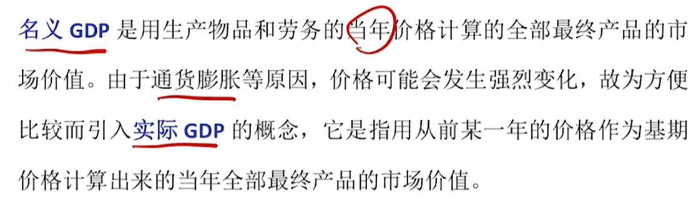
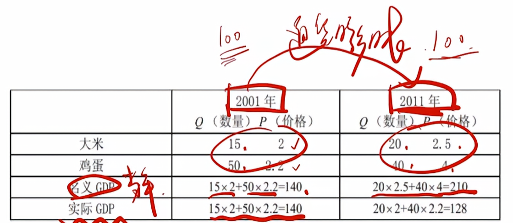
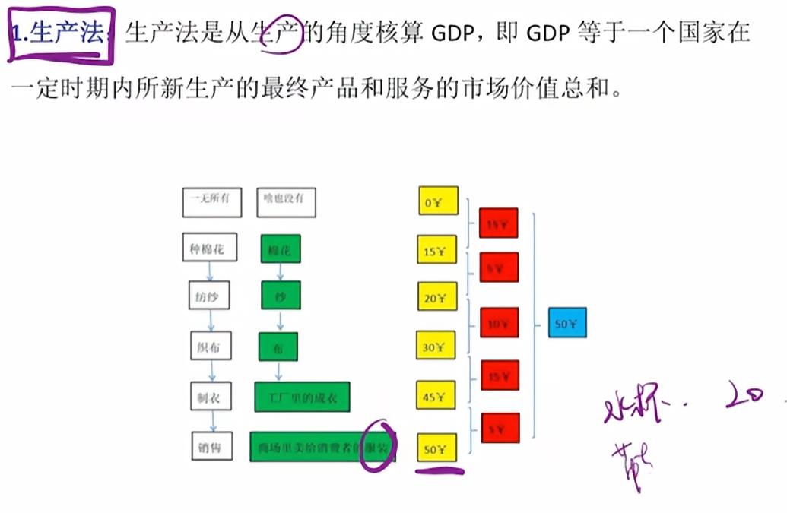
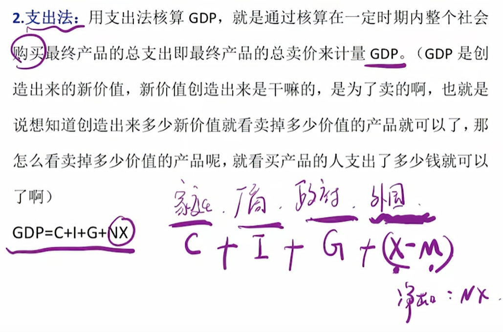
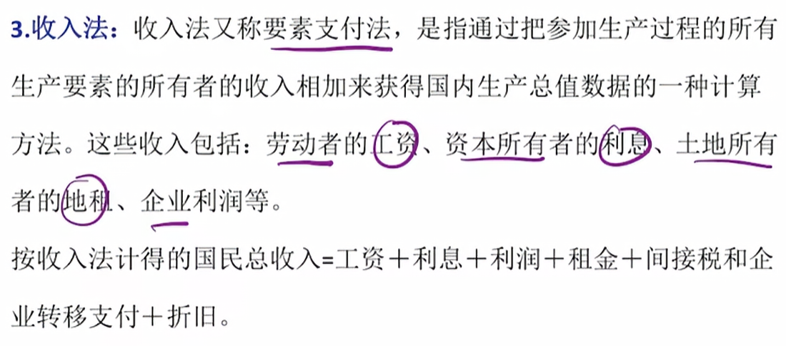
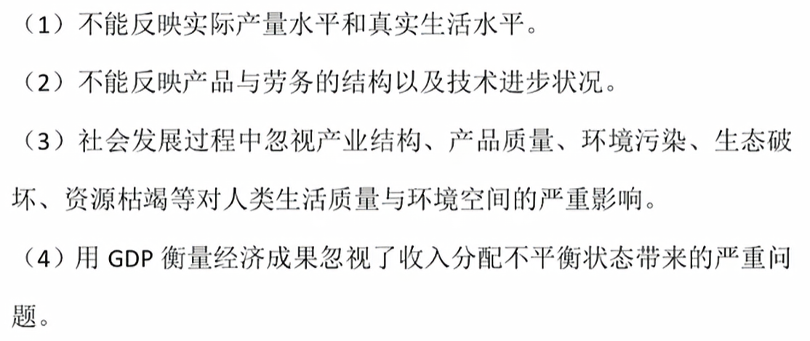
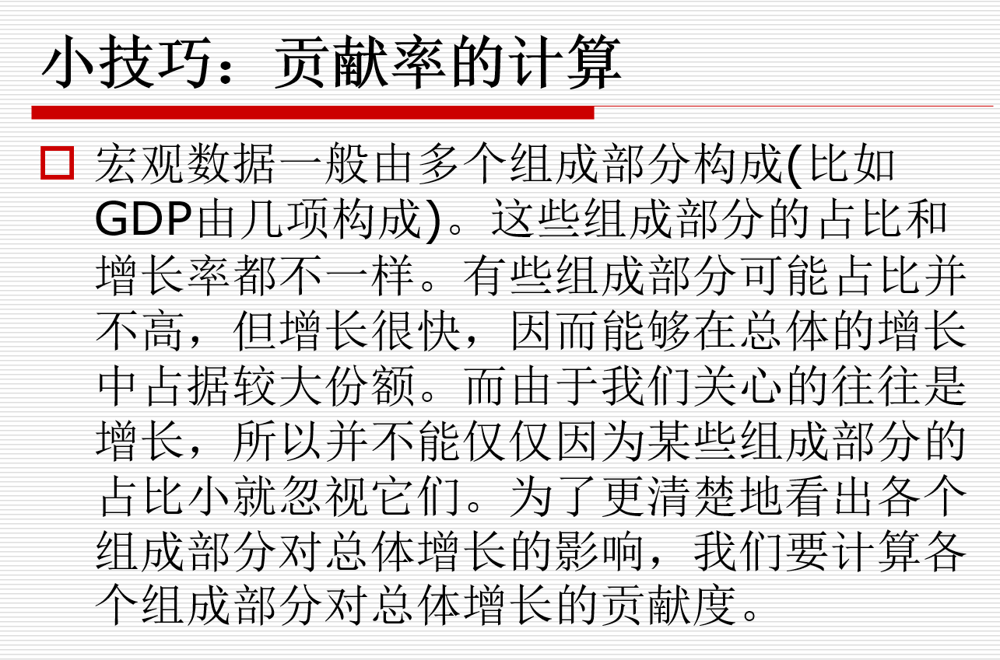
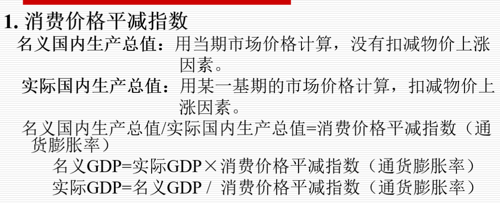
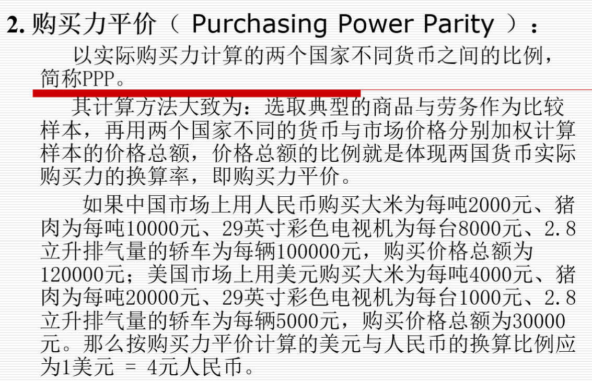

首先我们看一下我们的国民收入核算的几个指标

## GDP(gross domestic product)

首先看看我们的国民生产总值

国民生产总值主要指一个时期内国家或者地区范围内所生产的全部产品最终产品和劳务的市场总和

首先，我们的GDP是一个市场价值概念

第二，GDP统计的其实是最终产品而不是中间产品（主要衡量物料从进入到产出的过程）

最终产品供人们直接使用和消费，不再转卖的产品和劳务。

中间产品作为生产投入品，不能直接使用和消费的产品和劳务

第三，GDP按国土原则，而不按国民原则计算

第四，GDP是流量而非存量（流量指的是一定时期内发生或产生的变量，而存量是某一时点上观测或测量到的变量）

第五，GDP是一定时期内生产的，而不是销售掉的最终产品的价格

第六，GDP包含有折旧

所以用通俗的话来说，什么是GDP呢？

!!! note "note"
    国内生产总值其实就是一个国家或地区一年内创造出来的新价值，即价值增殖。

价值增值就是最终的钱和开始的时候发生了数量上的增加

我们来看下面这个例子：

假设某企业在某年生产和销售500万美元制成品，能否说这500万美
元就是这个“企业”的GDP呢，即能否说这500万美元都是这个企
业生产和创造的呢?不能!因为生产中必须耗费原材料、能源等等，
假定这些耗费是200万美元，则该企业新生产的价值只有300万美元，
这300万美元才是由这个企业创造出来的价值，即价值增殖，可以叫
这个“企业”的GDP。

## GNP(gross national product)

!!! note "note"
    指一个国家或者地区一定时期内由本地公民所生产的全部产品和劳务的市场总和

国内生产总值(GDP)的统计原则是国土原则，国民生产总值(GNP)的统计原则是国民原则。

GDP=本国居民在本国创造的价值+外国居民在本国创造的价值

GNP=本国居民在本国创造的价值+本国居民在外国创造的价值

GNP-GDP=本国居民在外国创造的价值-外国居民在本国创造的价值=NFP(净要素收入)

选一个作为基期就行了

## NNP（国民生产净值Net National Product）NDP（国内生产净值Net Domestic Product）

GNP和GDP扣除折旧之后的余额。他们是一个国家或地区一定时期内财富存量新增加的部分

## NI（国民收入 National Income）

NNP或NDP扣除间接税后的余额。它入体现了一个国家或地区一定时期内生产要素收入，即工资、利息、租金和利润的总和。

间接税指能够转嫁税负即可以通过提高商品和劳务的售价把税负转嫁给购买者的税收。这类税收一般在生产和流通环节征收，如增值税、营业税、关税等。

直接税指不能转嫁税负即只能由纳税人自己承担税负的税收。这类税收一般在收入环节征收，如所得税。

国民收入有广义和狭义两种用法。**广义的国民收入**就是指国民生产总值。宏观经济学中有“国民收入核算理论”、“国民收入决定理论”，这里的国民收入都是广义的。 

## PI（个人收入 personal income）

个人收入是一个国家或地区一定时间内个人所得的全部收入，它是国民收入经一些必要的调整之后形成的一个指标

最主要的扣减项有：公司未分配利润、公司所得税和社会保障支付；

最主要的增加项有：政府对个人的转移支付，如失业救济、退休金、医疗补助等。 

## DPI（个人可支配收入Disposable Personal Income）

个人收入扣除个人所得税以后的余额

## 相关公式数据

在进入下一个章节之前，我们不妨来看一下我们的相关公式

| 字母 | 英文 | 在公式中的含义 |
|---|---|---|
| **C** | Consumption | 消费：居民购买最终产品和服务 |
| **I** | Investment | 投资：如新机器、新厂房、新住宅以及存货变动 |
| **G** | Government purchases | 政府购买产品和服务；不包括单纯的转移支付 |
| **X** | Exports | 出口 |
| **M** | Imports | 进口 |
| **NX** | Net Exports | 净出口，\(NX=X-M\) |

## 几种核算GDP的方法

生产法从厂商的角度来说，看一家工厂在一年之内赚了多少

而支出法则看我们的消费者在过去的一年花了多少钱，这样就能看出来我们新生产的总值（消费是为了买东西，卖的东西是新生产的总值）

## 国民收入的基本公式（投资储蓄恒等式）

我们论证的核心是支出=收入

即投资=储蓄（I=S）

1. 两部门

假设我们只有家庭和企业

如果从支出角度，应该只有Y=C+I（消费和投资）

如果从收入角度，Y=C+S（消费和储蓄）（从事后的角度看）

所以C+I=C+S

所以两部门的投资储蓄恒等式是I=S

2. 三部门

假设有家庭、企业和政府

从支出的角度：Y=C+I+G (consumption+investment+goverment purchase)

从收入的角度：Y=C+S+T (consumption+saving+tax)

所以I=S+(T-G) 其中T-G就是政府的储蓄，所以我们最后得到的还是投资储蓄恒等式

3. 四部门

这个时候我们加上一个国外部门

从支出角度：Y=C+I+G+(X-M)

从收入角度：Y=C+S+T+K(K代表本国居民对外国人的转移支付，我们花在外国人身上的钱)

这个时候我们的等式就变成了

I=S+(T-G)+(M-X+K)后面这个括号内的是外国对本国的储蓄

但是我们GDP的衡量还是有问题的

## 贡献率

这个部分我在网课上好像没有看到，但是其实本质很简单，就是占比的问题

## 总产出核算的校正

