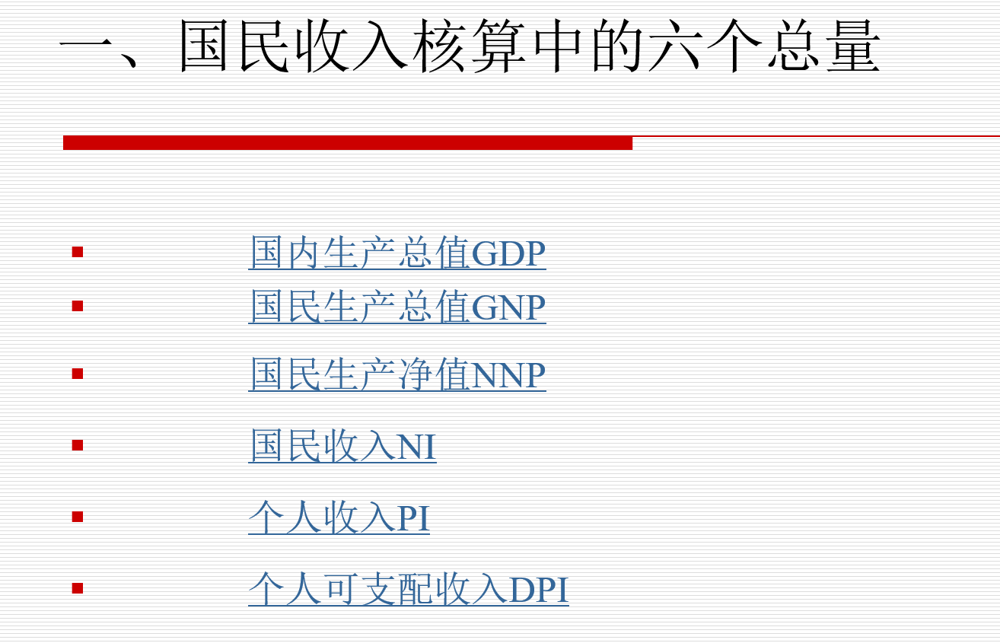
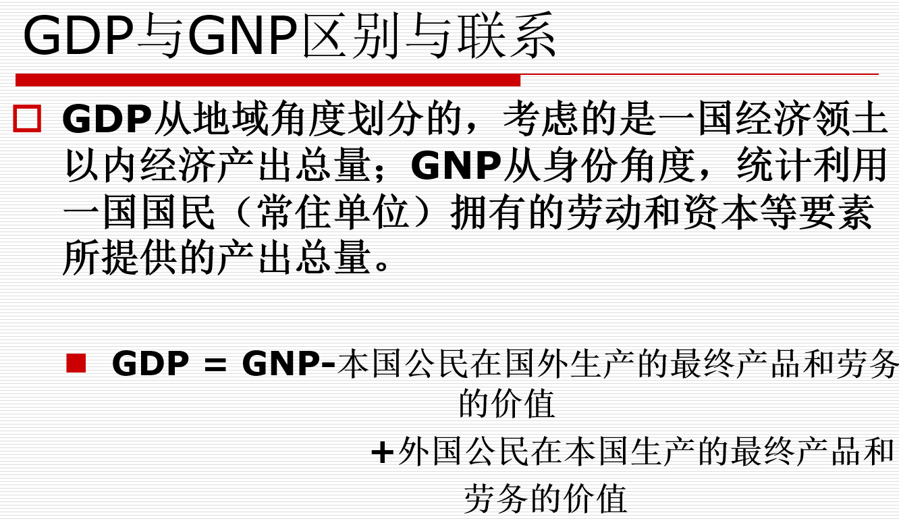
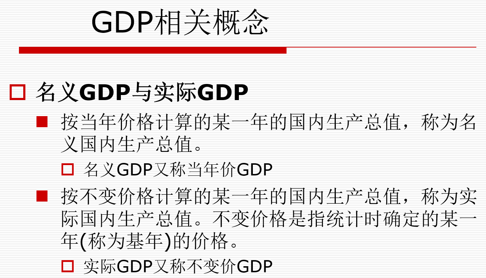

首先我们看一下我们的国民收入核算的几个指标

## GDP

首先看看我们的国民生产总值

国民生产总值主要指一个时期内国家或者地区范围内所生产的全部产品最终产品和劳务的市场总和

首先，我们的GDP是一个市场价值概念

第二，GDP统计的其实是最终产品而不是中间产品（主要衡量物料从进入到产出的过程）

最终产品供人们直接使用和消费，不再转卖的产品和劳务。

中间产品作为生产投入品，不能直接使用和消费的产品和劳务

第三，GDP按国土原则，而不按国民原则计算

第四，GDP是流量而非存量（流量指的是一定时期内发生或产生的变量，而存量是某一时点上观测或测量到的变量）

第五，GDP是一定时期内生产的，而不是销售掉的最终产品的价格

第六，GDP包含有折旧

所以用通俗的话来说，什么是GDP呢？

!!! note "补充说明"
    这里写正文。
    正文前面要缩进四个空格。

## GNP

指一个国家或者地区一定时期内由本地公民所生产的全部产品和劳务的市场总和

## NNP（国民生产净值）NDP（国内生产净值）

GNP和GDP扣除折旧之后的余额。他们是一个国家或地区一定时期内财富存量新增加的部分

## NI（国民收入 nationality income）

NNP或NDP扣除间接税后的余额。它入体现了一个国家或地区一定时期内生产要素收入，即工资、利息、租金和利润的总和。

间接税指能够转嫁税负即可以通过提高商品和劳务的售价把税负转嫁给购买者的税收。这类税收一般在生产和流通环节征收，如增值税、营业税、关税等。

直接税指不能转嫁税负即只能由纳税人自己承担税负的税收。这类税收一般在收入环节征收，如所得税。

国民收入有广义和狭义两种用法。**广义的国民收入**就是指国民生产总值。宏观经济学中有“国民收入核算理论”、“国民收入决定理论”，这里的国民收入都是广义的。 

## PI（个人收入 personal income）

个人收入是一个国家或地区一定时间内个人所得的全部收入，它是国民收入经一些必要的调整之后形成的一个指标

最主要的扣减项有：公司未分配利润、公司所得税和社会保障支付；

最主要的增加项有：政府对个人的转移支付，如失业救济、退休金、医疗补助等。 

## DPI（个人可支配收入）

个人收入扣除个人所得税以后的余额

