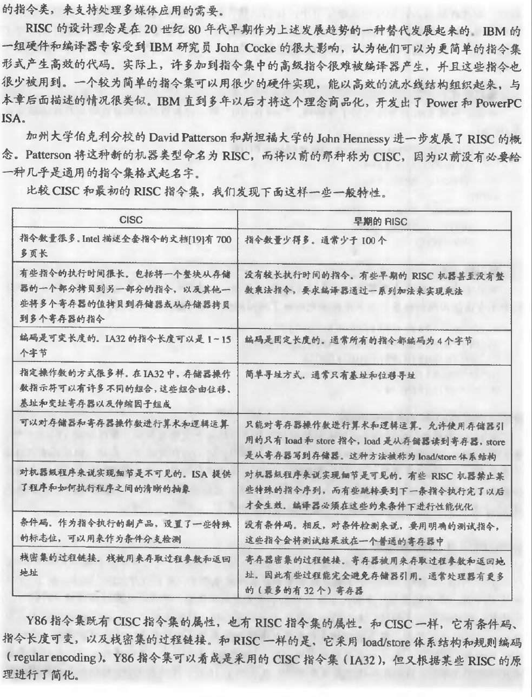
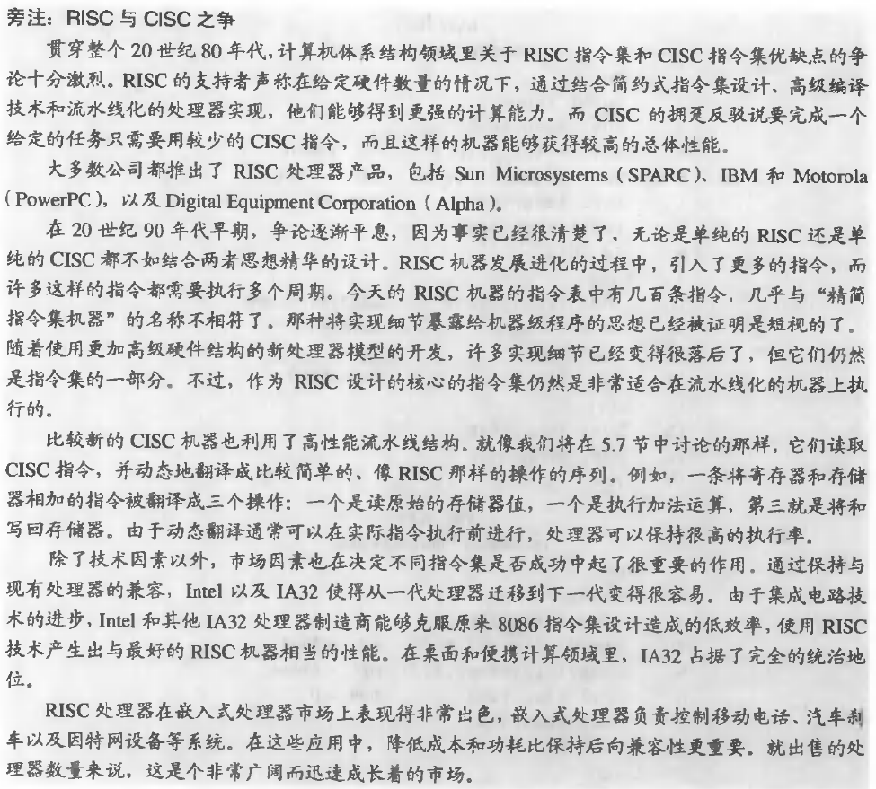
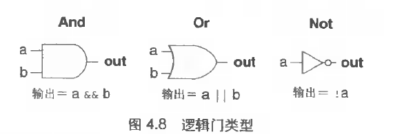
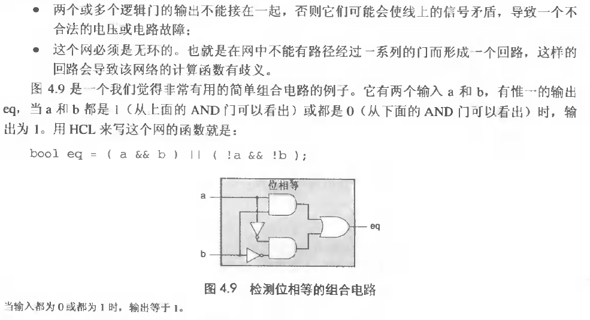
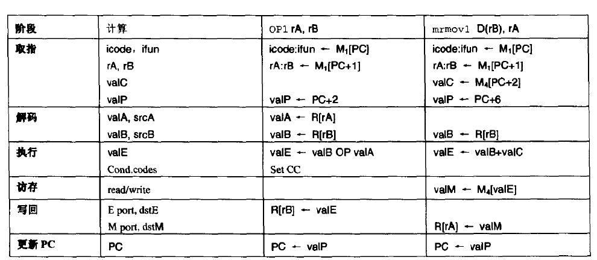
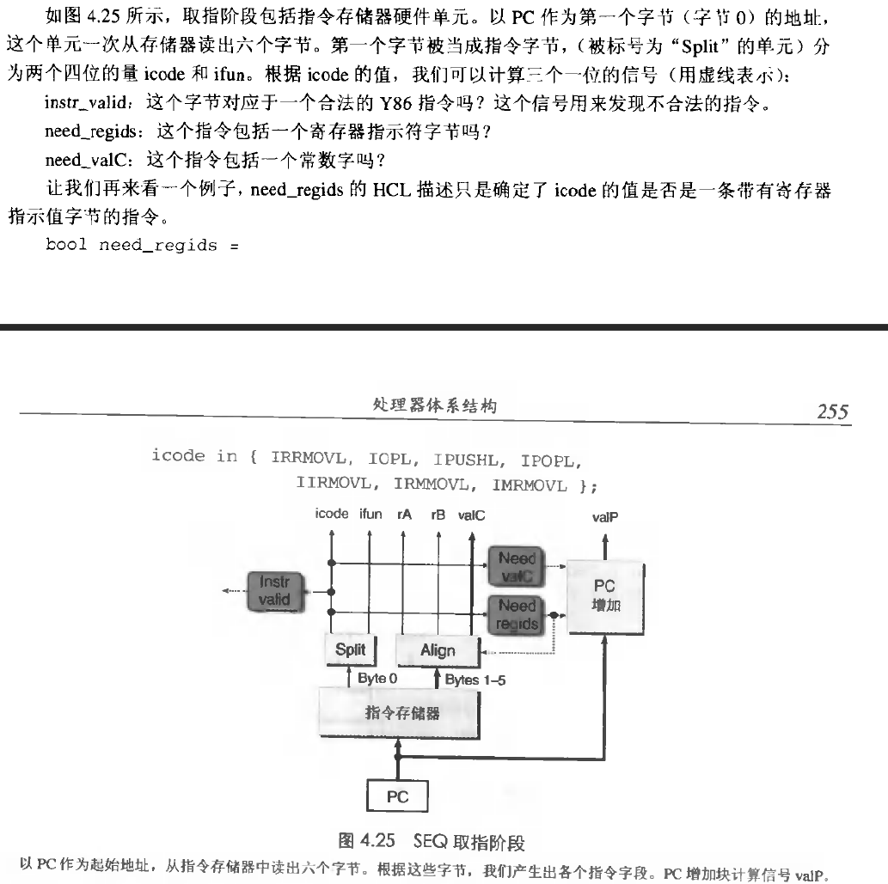

## 前言

这个章节很多题目主要聚焦于我们的Y86架构（这个章节更多的其实是去练习，在最后的练习中学会我们的）

Y86架构受到X86的启发，不过是一种专门为了教学而产生的简化指令集

在开始之前，我们不妨看一些比较有趣的小知识

## 逻辑设计和硬件控制语言HCL

这是我们构成逻辑门的最基础的原件，当然他们最后都能归结到二极管上，然后是pn结，最后回到半导体的电子偏移上

将很多的逻辑门组成一个网，我们就能够得到计算块

当然，计算块本身也存在着一些限制，我们这里可以看看4.9中的例子来了解我们的所谓组合电路

## SEQ硬件结构

以上取址-译码-执行-访存-写回-更新 的形式也是我们正常程序编译执行的标准方式

可是现实中我们要怎么实现我们的更新呢，这个部分我们通过计时器(timer)，时序(timing)，周期/拍(cycle)来实现

### 取值

### 解码和写回

### 执行

### 访存

### 更新PC

