## 前言

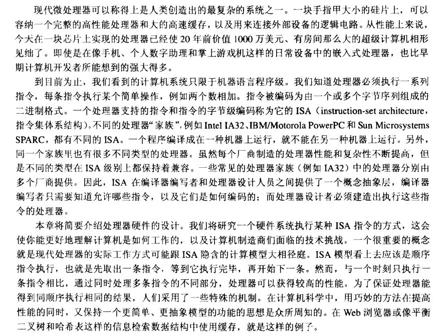


这个章节很多题目主要聚焦于我们的Y86架构（这个章节更多的其实是去练习，在最后的练习中学会我们的）

Y86架构受到X86的启发，不过是一种专门为了教学而产生的简化指令集


在开始之前，我们不妨看一些比较有趣的小知识

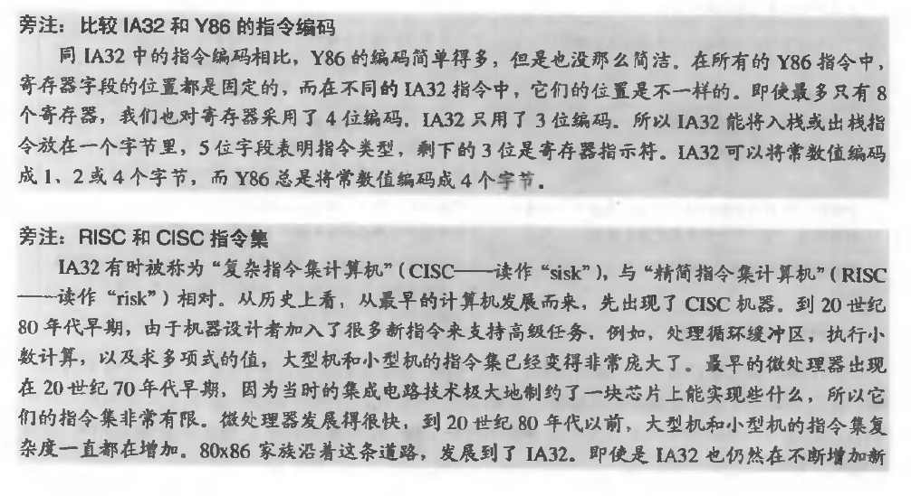


## 逻辑设计和硬件控制语言HCL


这是我们构成逻辑门的最基础的原件，当然他们最后都能归结到二极管上，然后是pn结，最后回到半导体的电子偏移上

将很多的逻辑门组成一个网，我们就能够得到计算块


当然，计算块本身也存在着一些限制，我们这里可以看看4.9中的例子来了解我们的所谓组合电路

## SEQ

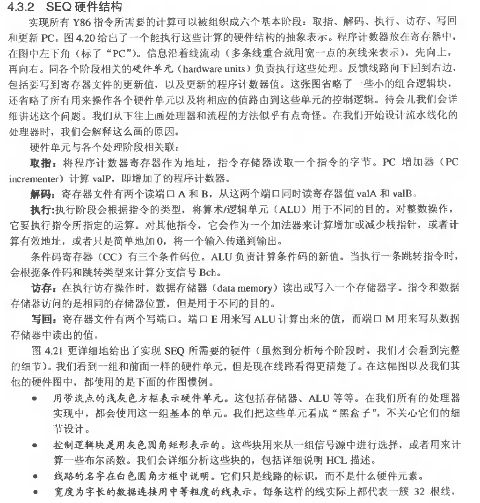

以上取址-译码-执行-访存-写回-更新 的形式也是我们正常程序编译执行的标准方式

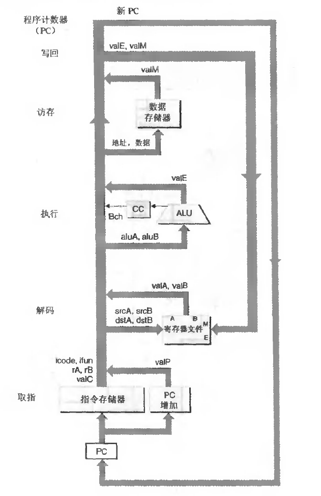

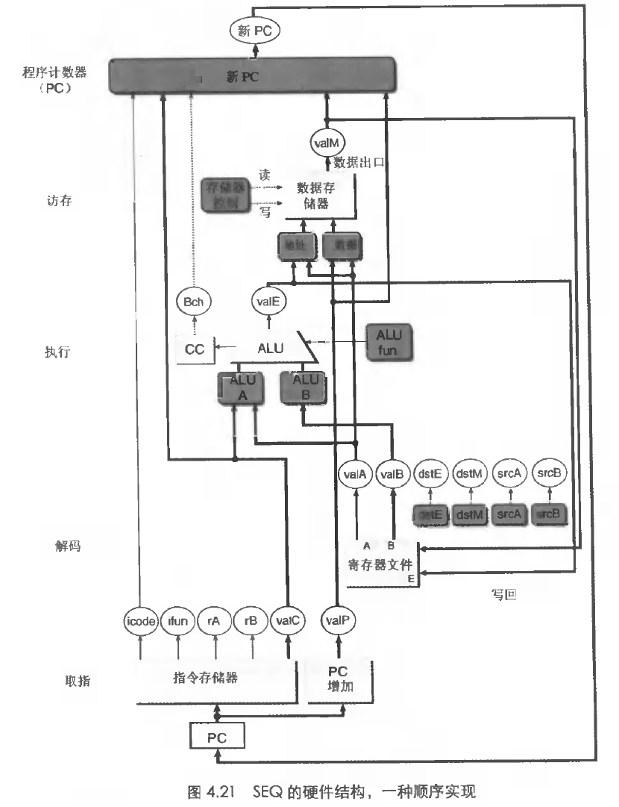


可是现实中我们要怎么实现我们的更新呢，这个部分我们通过计时器(timer)，时序(timing)，周期/拍(cycle)来实现

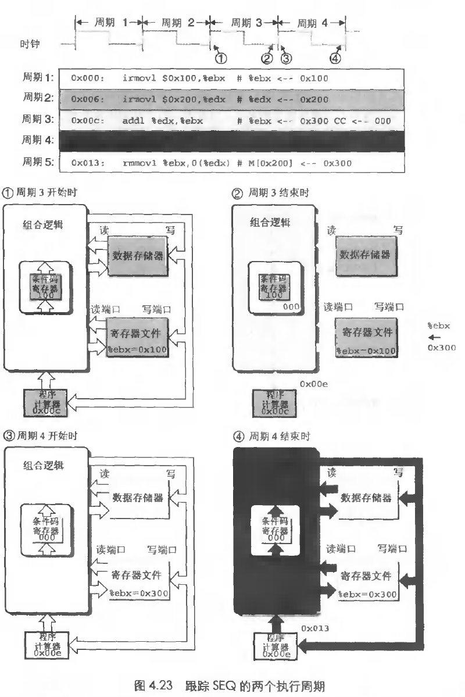

### 取值


这个部分指令储存器以我们的PC为起点，输出一个足够容纳最长指令的6字节窗口（注意，只是这个地方是6字节，视情况而定）

而一个32位的指令可能包含以下内容

| 字段 | 作用 |
|---|---|
| `icode` | 指令类别，例如加法类、加载、存储、调用 |
| `ifun` | 同一类别中的具体功能，例如加、减、与、异或 |
| `rA`、`rB` | 指令中指定的寄存器编号 |
| `valC` | 指令里直接编码的常数，例如立即数、偏移或跳转目标 |

而组件split就负责了把一个字节分成4位的字段icode ifun

而组件align则根据有没有寄存器编号字节，正确选出 `rA`、`rB` 和 `valC`

所以对于例子

```asm
mrmovl 8(%ebx), %eax
```

我们的提取结果就是

icode：内存到寄存器的传送

rA：eax

rB：ebx

valC：8

然后我们的控制电路在得到了这些消息之后生成以下内容

need_regids = 1    需要寄存器编号字节

need_valC   = 1    需要4字节常数

instr_valid = 1   是支持的指令类别

然后算出下一条指令的地址：

$$
valP = PC+1+need_regids+4 \times need_valC
$$

### 解码和写回

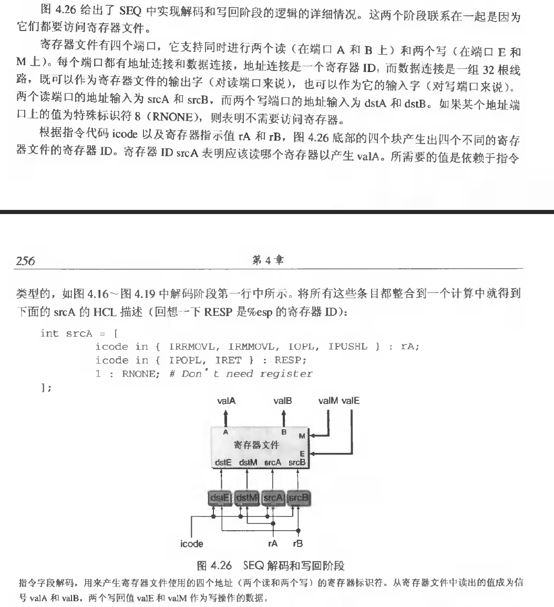

这个部分就是我们其他原件干的事了，他们接受到我们输出的代码，然后接着开始想怎么实现我们的操作，然后写回

rB = ebx的编号

valB = ebx里面保存的值

我们图中的寄存器有两个读端口

所以正常的流程应该是

srcA → 选择一个寄存器 → 输出 valA

srcB → 选择一个寄存器 → 输出 valB

控制电路根据 `icode`、`rA`、`rB` 决定 `srcA` 和 `srcB`。

所以我们的值应该是

```
srcA = RNONE       不需要从A端口读取有效操作数
srcB = ebx
valB = 0x200
```

这个时候我们发现我们的寄存器文件还有两个写端口：

E端口：将 valE 写到 dstE 指定的寄存器

M端口：将 valM 写到 dstM 指定的寄存器

本例：

dstE = RNONE        ALU算出的地址不需要写回寄存器

dstM = eax

valM = 123

因此最终

eax = 123

不过这个地方为什么有两个写端口感觉还是有点问题，可以看看gpt老师的解释

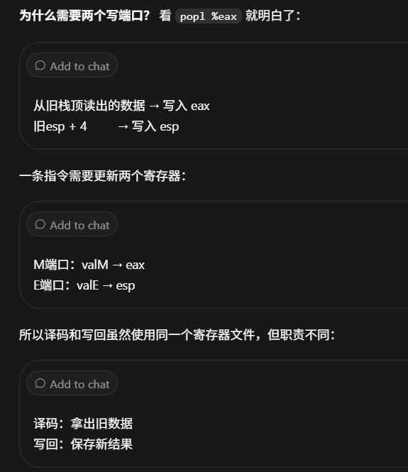

### 执行

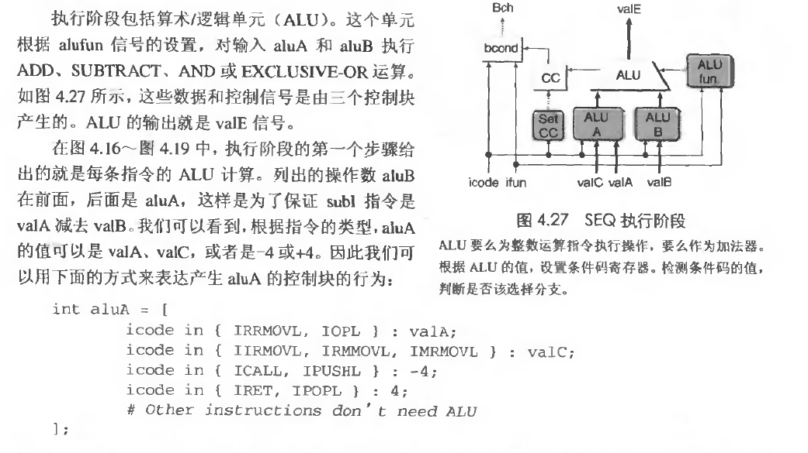

执行的过程其实很简单，就是我们从我们的寄存器中读取我们的ALV参数，然后接着开始执行相关的操作

### 访存

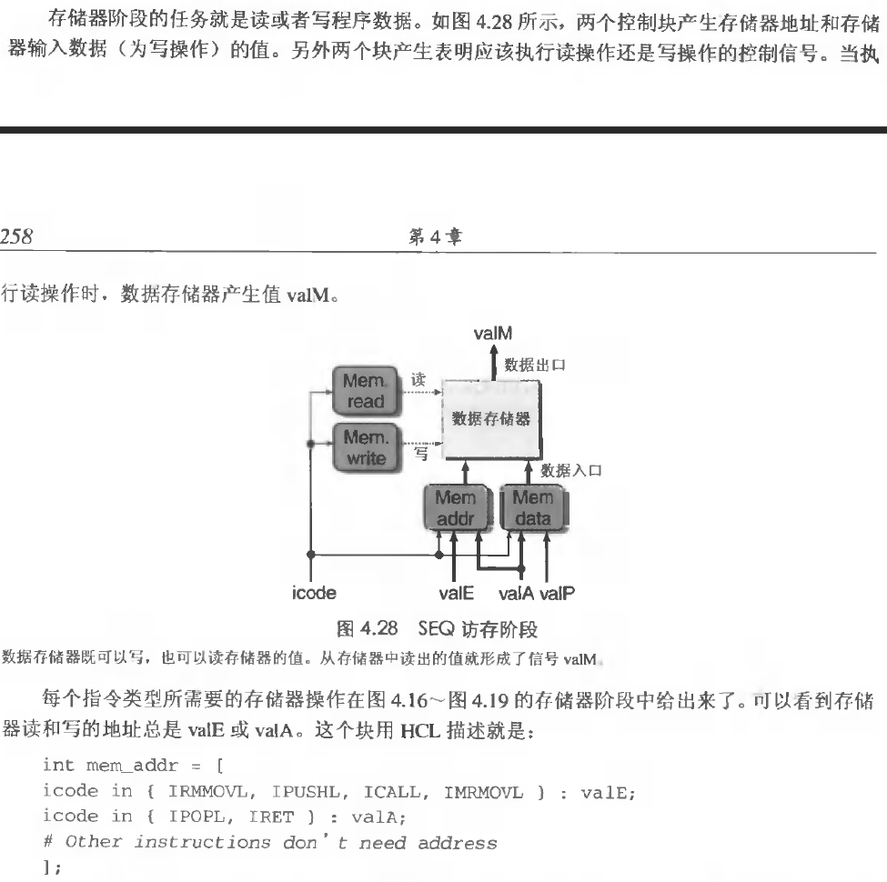

地址算好以后，数据存储器还需要四个控制信息：

| 信号 | 回答的问题 |
|---|---|
| `mem_read` | 是否读取？ |
| `mem_write` | 是否写入？ |
| `mem_addr` | 访问哪个地址？ |
| `mem_data` | 如果写入，写什么？ |

```
mem_read  = 1
mem_write = 0
mem_addr  = valE = 0x208
```

所以我们的读取结果就是

$$
valM = M_4 [0x208] = 123
$$

### 更新PC

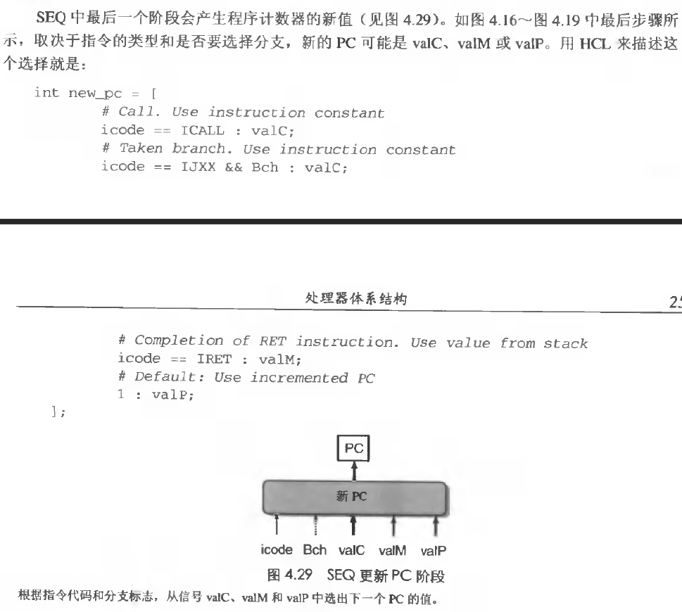

图中 PC 输入前面的方块，本质上是一个选择器：

| 情况 | 新 PC 选择 |
|---|---|
| 普通顺序执行 | `valP` |
| `call` | `valC`，指令中编码的目标地址 |
| 分支跳转成立 | `valC` |
| 分支跳转不成立 | `valP` |
| `ret` | `valM`，从栈里读出的返回地址 |

首先我们的加载指令没有影响控制流

然后这个地方我们可以看一下call和ret的配合

```
call：
    把 valP 写进栈，留下“回来以后去哪里”
    把 valC 送给 PC，决定“现在去哪里”

ret：
    从栈读出返回地址，成为 valM
    把 valM 送给 PC
```

## 流水线 pipeline

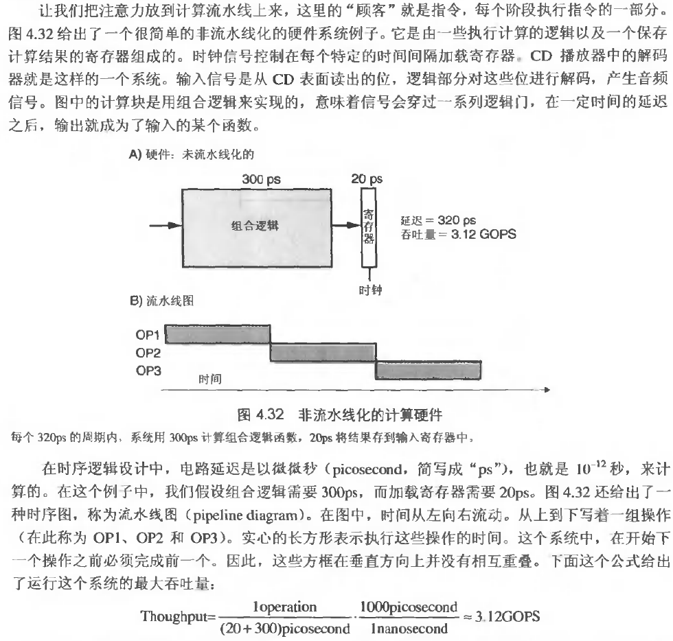

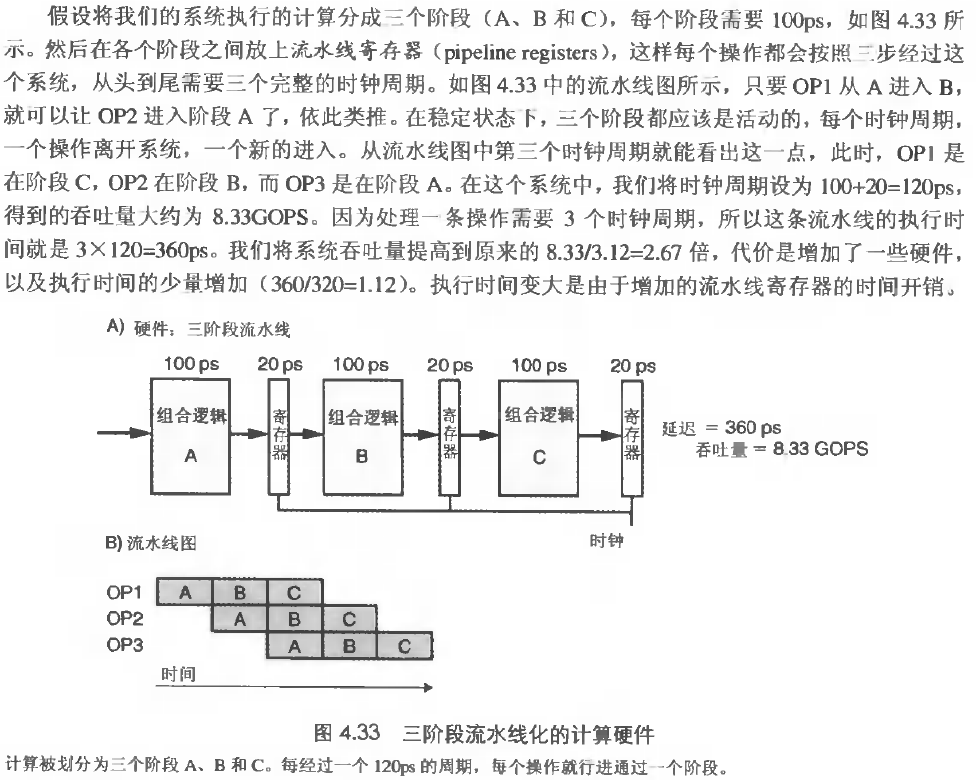

下面这张图很清楚地展示了一个流水线是怎么实现多个操作并行的

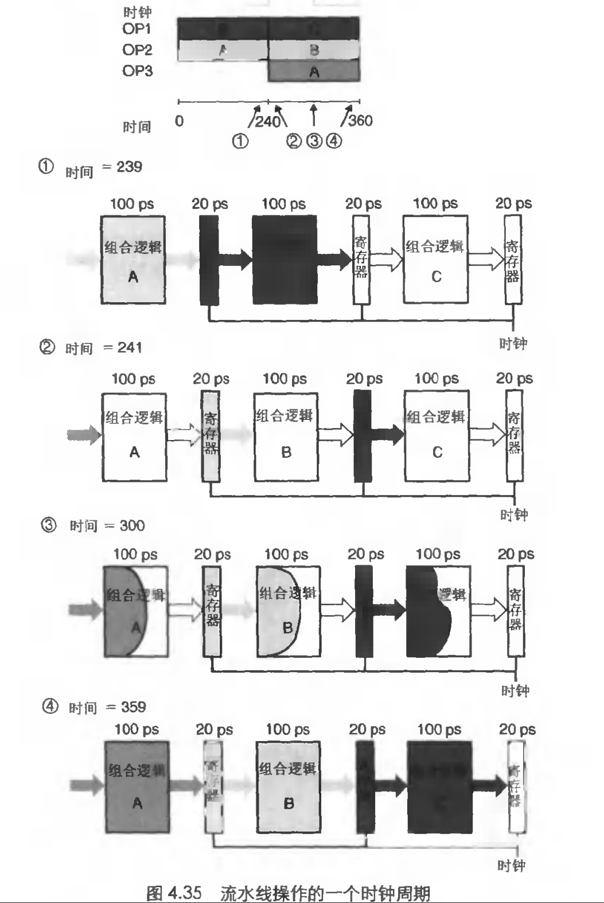

当然，流水线的架构也有他的局限性在

首先是我们的时钟问题，我们的流水线中抽象以后其实就只有两步，一步是组合逻辑，另一步是吧最后的结果写回我们的寄存器

在这个过程中我们的时钟如果周期很慢其实反而没有什么问题，但是如果周期很快的话就会导致我们的组合逻辑还没有执行完，导致传入我们寄存器内的东西是一个非法值

第二个问题是我们的等待问题

流水线中的周期以我们时间最长的操作决定，但是当很多时候我们没有办法利用掉我们的时间时问题就会发生——我们执行的快的步骤很有可能需要去等待我们的整体周期，这个过程中同样也存在着开销

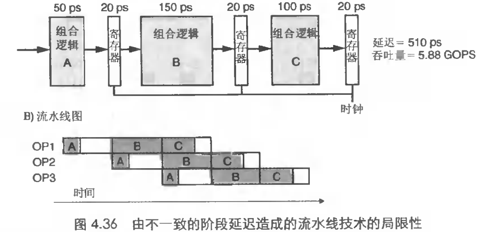

第三个问题是我们流水线寄存器的开销

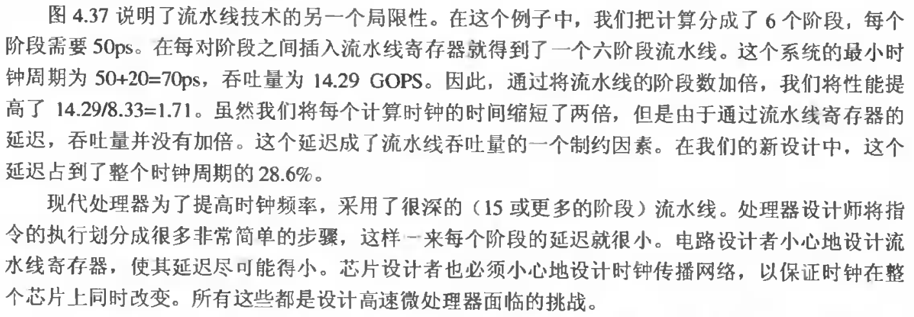

### 反馈

上面的问题很大程度上是由于我们的参数需要到我们的寄存器里面过一层，但是我们知道我们很多情况下我们的寄存器内容其实是共享的，所以我们为什么不去直接把我们的值做一个传入呢，从这个方向就能够跳过我们在寄存器上的开销

### Y86流水线实现

首先我们在之前说过了我们的SEQ处理器架构

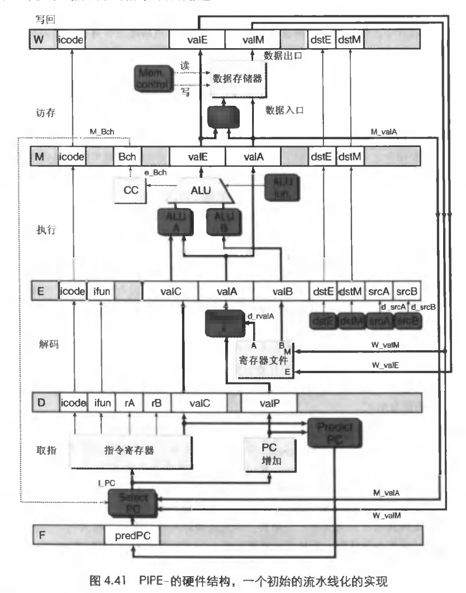

所以这个地方本质上只要对Y86重新做解析就行了

