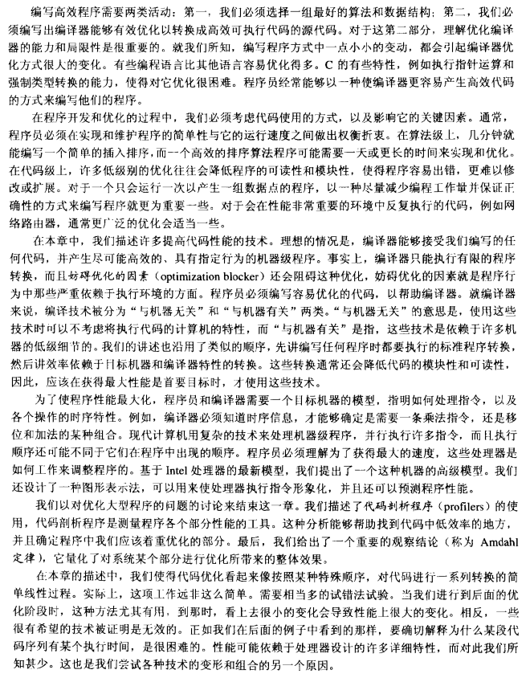
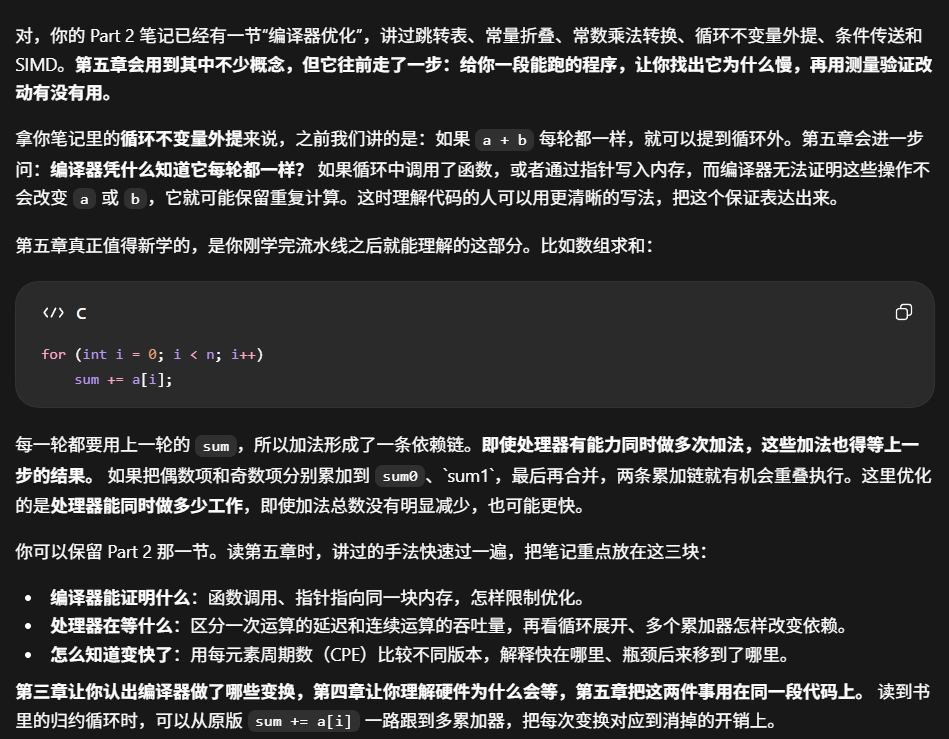
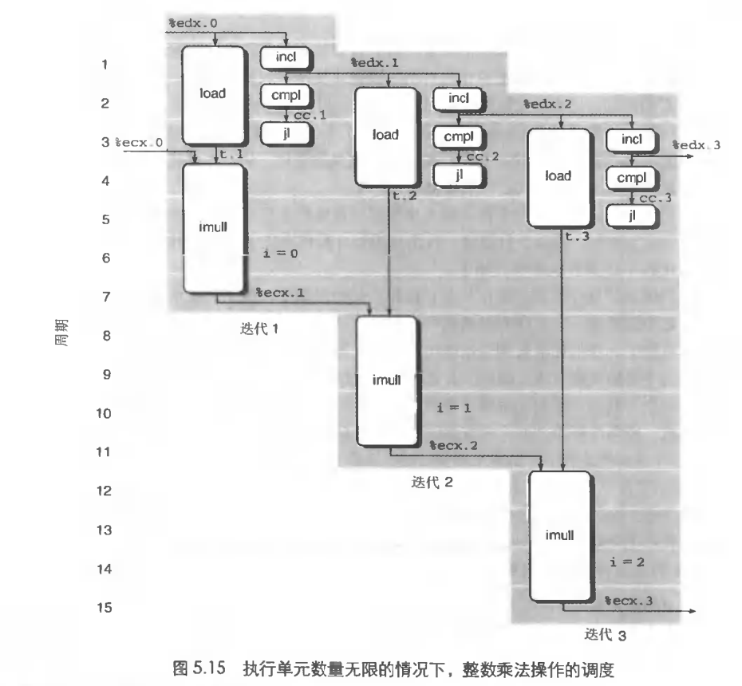
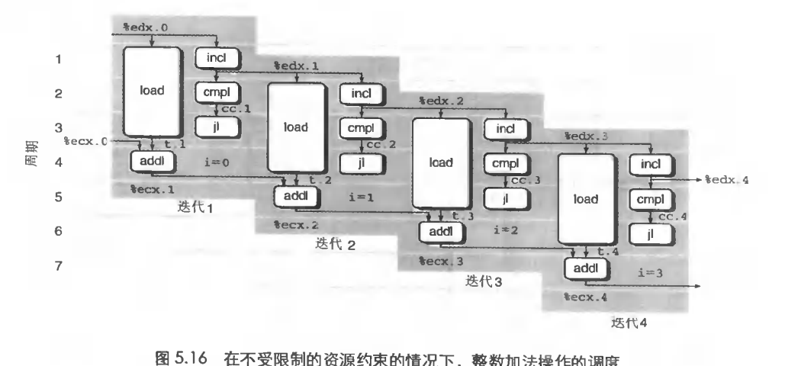
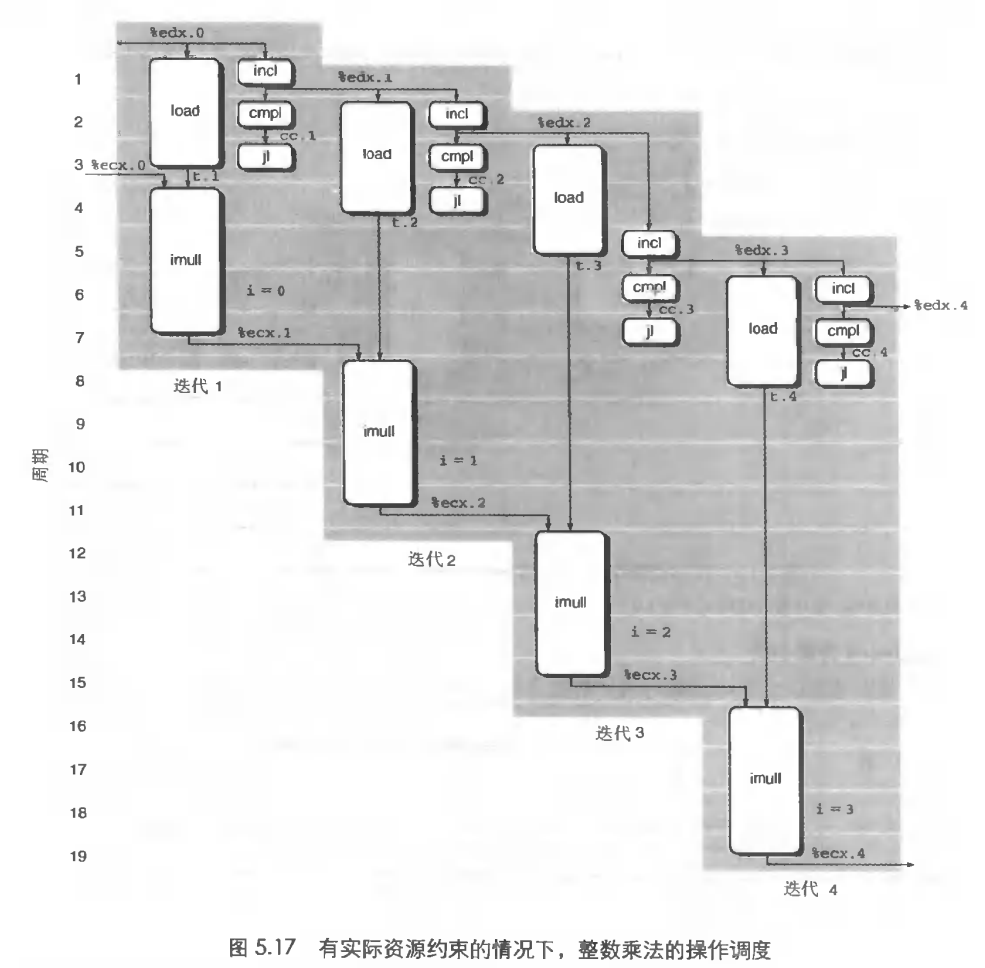
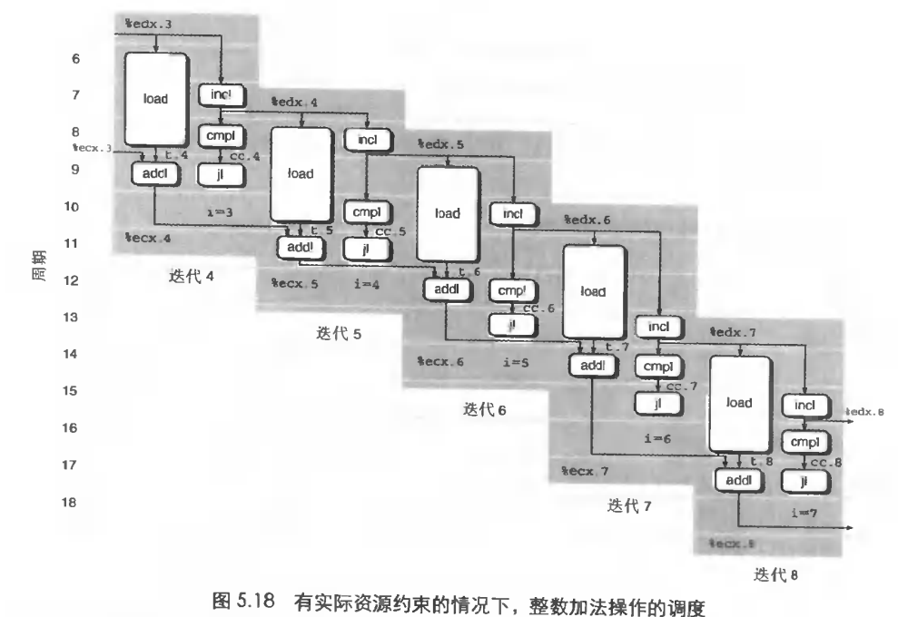

## 前言



不过不知道为什么这个章节的内容其实我在Part2中间也提到过，当时是看着视频学的所以可能会有很多重叠吧

以下是codex给出的注意点



## 衡量程序性能

首先最直观的其实就是我们程序的运行时间，这个地方其实我们直接看一下运行时间和周期数就行了，但是我们还想知道我们是怎么处理一个元素的

所以我们要知道怎么衡量我们程序的效率，这个地方我们引入CPE

**CPE（Cycles Per Element）就是每处理一个元素，平均花多少个 CPU 时钟周期。** 在 CSAPP 第五章里，通常测不同长度的数组，用**总周期数随元素数量增长的斜率**来算。

假设我们测一个数组求和函数，得到：

| 元素数量 | 总周期数 |
|---:|---:|
| 100 | 250 |
| 200 | 450 |

多处理 100 个元素，多用了 200 个周期，所以：

$$
\mathrm{CPE}=
\frac{\text{增加的周期数}}{\text{增加的元素数}}
=\frac{450-250}{200-100}
=2\text{ 周期/元素}
$$

而我们正常的CPE满足这个关系，因为我们固定会有50个周期的开销

$$
\text{总周期数}=50+2\times\text{元素数量}
$$

## 优化的路径

这个地方我做了一层抽象，主要也是通过一些其他的课程来实现了补全，我们从几个要做的事情上看我们的编译器到底做了个什么样的优化

我们不妨以一个数组求和的例子来看看我们的优化是怎么发生的

### 怎么去掉重复的工作

```c
for (size_t i = 0; i < length(v); i++)
    *dest += data[i];
```

从C代码上看，我们每轮工作是加元素并且重新读取长度。如果我们的长度在循环期间固定，我们的结果只要
在循环结束之后交出，所以我们的这两个工作就可以放到我们的循环外面

```c
size_t n = length(v);
unsigned sum = 0;

for (size_t i = 0; i < n; i++)
    sum += data[i];

*dest = sum;
```

我们把取长度变成一次，把中途的和放在局部变量里，编译器就有机会用寄存器保存它，最后才写回内存。当然，如果 dest 恰好指向数组中后面要读的元素，原版每轮写入就可能改变后续读到的数据，这时候就不能直接这么改。优化之前得先确认，被我们移走的操作会不会影响后面的计算。

当然你可能会说：我记得我们的优化主要发生在我们的汇编侧啊，你这不是主要聚焦在算法侧上嘛

那确实，但是我们做一次转化就好了

```asm

movl (%rdx), %eax    # 从内存读出上一次的和
addl (%rdi), %eax    # 读当前数组元素，加到和上
movl %eax, (%rdx)    # 把新的和写回内存

```

如果能证明中途写入 *dest 不会影响后续读取，就可以把和留在 %eax，循环里只保留 addl (%rdi), %eax，最后再写回。数组元素还是得读，省下来的是每轮对累加结果的读写。 同理，循环不变量外提的效果，就是某个计算或函数调用从循环里的那条回跳路径移到了循环之前。

### 怎么实现计算的并行

把多余的工作去掉以后，剩下的加法还是一条链。第 2 次加法要等第 1 次算出 sum，第 3 次又要等第 2 次。就算 CPU 能在同一时间推进多个加法，这条链也很难用满它的能力。

这里我们可以先做循环展开，比如每轮处理两个元素。只看展开后的循环体，最后剩下的单个元素另外处理：

```c
sum += data[i];
sum += data[i + 1];
```

这样每处理两个元素只需要做一轮循环判断、下标更新和跳转。但下面那次 sum += 还在等上面那次。接下来才是多个累加器：

```c
sum0 += data[i];
sum1 += data[i + 1];
```

同样，这个地方我们做一层翻译就行了

```asm
# 一个累加器
addl  (%rdi), %eax
addl 4(%rdi), %eax

# 两个累加器
addl  (%rdi), %eax
addl 4(%rdi), %ecx
```

### 怎么找出真正的瓶颈

我们对上面的修改采用cpe的分析方法，最后就能得到我们的优化效益

## 资源调度的影响









这个地方我们可以看见我们的加法和乘法在我们执行中的区别

我们会发现乘法基本没有变化，因为我们乘法中的imull执行了太多拍，这会导致我们的很多步骤在等待的过程中就直接解决掉了

但是我们的加法存在着分别

addl 本身始终只要 1 拍，但资源有限时，整个循环从平均 1 拍处理一个元素，变成了平均 2 拍处理一个元素。

资源充足时，前四轮的 addl 分别在第 4、5、6、7 拍执行。上一轮的和刚算出来，下一轮就能接着加。与此同时，其他迭代的下标更新和分支判断也能推进。

看图 5.18，资源有限时，每轮除了 addl，还有 incl、`cmpl`、`jl`。课本模型中，这四个操作共用每拍两个执行名额。每轮处理一个元素，所以平均至少需要：

$$
\frac{4\text{ 个操作／元素}}{2\text{ 个操作／拍}}
=2\text{ 拍／元素}
$$

`load` 由单独的加载单元处理。图里第 4 轮的 `addl` 在第 9 拍，第 8 轮在第 17 拍，隔了 4 个元素、8 拍，正好是 **CPE = 2**。