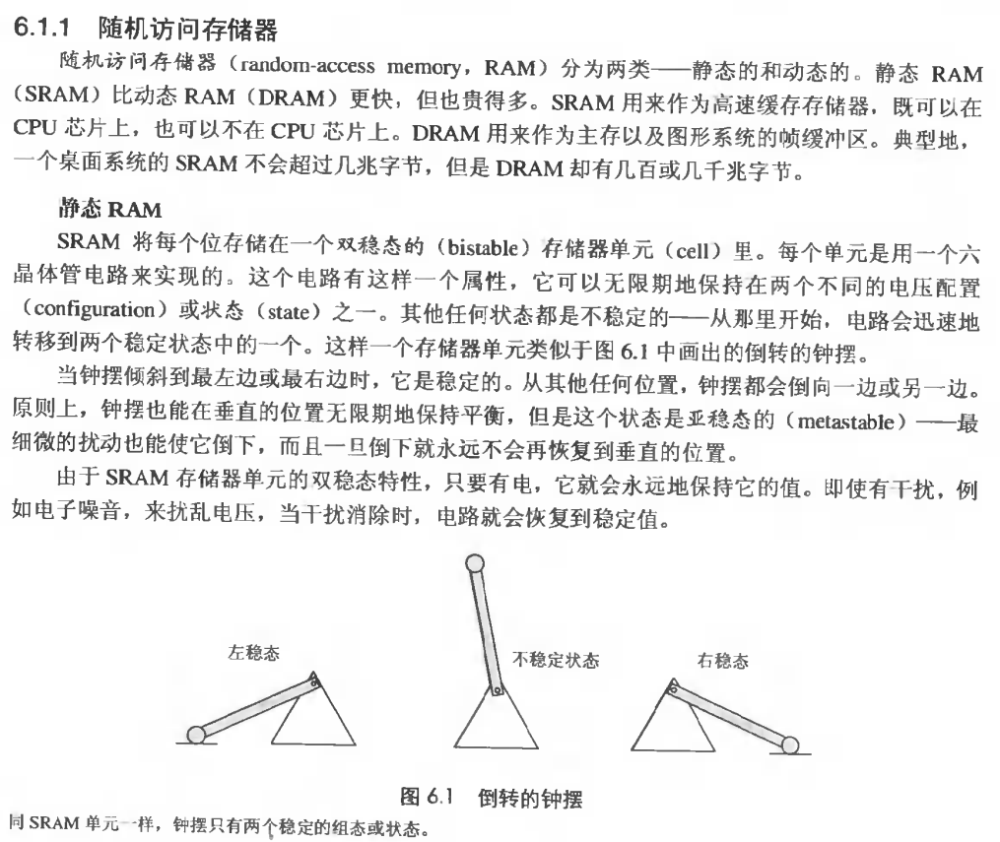
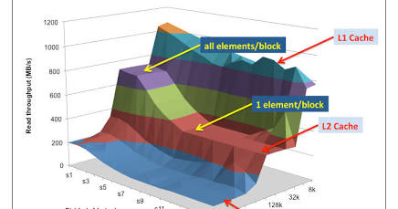

## 存储技术

> **一句话总纲**：存储层次靠**局部性原理**（时间 + 空间）赚钱，靠**整块搬运 + 逐级分层**省成本、压延迟、拉高吞吐；写代码的核心抓手就是让工作集贴合缓存容量、让地址访问顺着缓存行走。

---

### 一、 访存搬运与局部性

* **整行搬运（64B Cache Line）**：缓存按块（常见 `64B`）从下层搬数据，而不是按单变量字节搬。对齐首地址读 `int a[0]`（`4B`）时，整条 `64B`（`a[0..15]`）一起进缓存。
* **步长决定有效带宽**：设缓存行 `64B`、元素 `4B`，每次循环有效搬运量可记作：
* **步长 `1**`**：每 `16` 次读才 `1` 次 miss → 平均每次读搬运 `4B`（行内 `16` 个元素全用满）。
* **步长 `8**`**：每条行用 `2` 个元素 → 平均每次读搬运 `32B`。
* **步长 `16`（或 `>= 16`）**：每次读都跨行 miss → 每次读搬运 `64B`，却只用 `4B`。

* **空间局部性（Spatial Locality）**：访问某地址后，邻近地址很快会被访问；跳步过大直接浪费缓存行内未使用的字节。

---

### 二、 地址切分与三大 Miss

假设参数为 $(S, E, B)$（组数 $S = 2^s$，每组路数/行数 $E$，块大小 $B = 2^b$ 字节）：

| 地址字段 | 位宽 | 作用 | 算例（$B=16\text{B}, S=4, E=1$，地址 `0x0040`） |
| --- | --- | --- | --- |
| **Tag（标记）** | 剩余高位 | 辨认当前槽位存的是哪一块内存 | `0x0040` 二进制 `0000 0000 01` | `00` | `0000` → Tag = `1` |
| **Set Index（组索引）** | $s = \log_2 S$ 位 | 定位去哪一组 | `00` → 第 `0` 组 |
| **Block Offset（块内偏移）** | $b = \log_2 B$ 位 | 定位该行里的具体字节 | `0x0` → 行内第 `0` 字节 |

* **强制性 / 冷不命中（Compulsory Miss）**：块第一次被访问，必然 miss。
* **冲突不命中（Conflict Miss）**：缓存总容量足够，但多块地址映射到同一组且超出路数 $E$，互相挤出；严重时出现**抖动（Thrashing）**。增大组相联度 $E$ 或做地址错位/填充（Padding）可缓解。
* **容量不命中（Capacity Miss）**：工作集总大小超过缓存容量，旧行被新行挤出，回头再访时 miss。

---

### 三、 矩阵遍历与分块优化

* **行优先 vs 列优先**：C 语言按行连续存放二维数组。按行扫顺序走缓存行，命中率高；按列扫跨行步长等于整行字节数，若行跨度乘以行数超过缓存容量，刚被踢出的行再回来就会 miss。
* **矩阵分块（Blocking / Tiling）**：把大矩阵拆成能塞进 L1/L2 的小块，算完块内乘加再换块，让同一份缓存行数据在被驱逐前被**多次复用**，保住**时间局部性（Temporal Locality）**。

---

### 四、 存储器山与延迟 vs 吞吐量

* **存储器山三轴**：
* **X 轴（步长 `stride`）**：看空间局部性。步长越大，单次访存有效利用的块内字节越少，吞吐量沿斜坡下滑，跨过整行后趋于平底。
* **Y 轴（工作集大小 `size`）**：看时间局部性。工作集跨越 L1 / L2 / L3 / 主存边界时，吞吐量呈阶梯式下跌。
* **Z 轴（读取吞吐量 `Read throughput`）**：单位时间内成功读取的数据量。

* **单次加载延迟（第 5 章） vs 读取吞吐量（第 6 章）**：
* **单次加载延迟**：看**串行依赖链**（如指针追踪 `p = p->next`），一次 `load` 没回来就算不出下一个地址，测的是单次往返周期数。
* **读取吞吐量**：看**并发与预取**（如无依赖的数组累加），靠 **MLP（内存级并行）** 和**硬件预取器**把多个访存压在流水线里一起跑，测的是带宽上限。

---

### 后记

这个板块其实我在HPC101里面和很多文章里面都提到过，所以这个地方我就简单写一下了，不多多赘述了，然后回看的话你会发现这种分块的思想在很多地方都用得到，从我们宏观的硬盘在到我们内部的小内存，或许对于一个查询类型的组件分块就是一件很轻松的事情吧