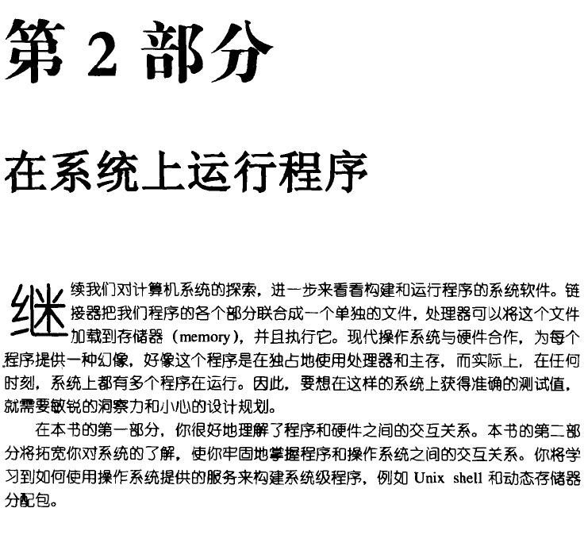
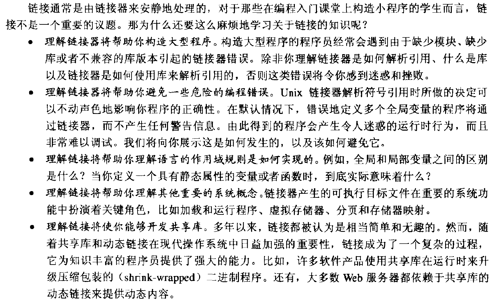

## 在系统上运行程序

课本上从连接开始进入了我们的第二个章节——在系统上运行程序

## 所谓链接

链接就是将不同的代码和数据收集和组合成一个单一文件的过程，在早期的计算机系统中，链接时手动执行的，不过现在链接时由linker自动执行的

链接器在软件开发中扮演着一个关键的角色，因为它们使得分离编译(separate compilation)成为可能。我们不用将一个大型的应用程序组织为一个巨大的源文件，而是可以把它分解为更小、更好管理的模块，可以独立地修改和编译这些模块。当我们改变这些模块中的一个时，我们只要简单地重新编译它，并将它重新链接到应用上，而不必重新编译其他文件。

当然，你可能会问：这样一个如此底层的轮子，为什么还会需要我们去学习呢？他难道不就像今天的x86一样是不必要的吗

