这次分享整理成了逐页图片与讲解。内容包括主板、CPU、内存与缓存、存储和传输、GPU，以及程序运行时操作系统参与的工作。

## 01 考拉工作室信息资源部分享会

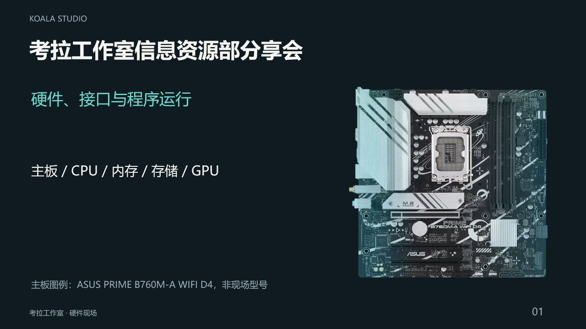

## 02 主板上的接口与位置

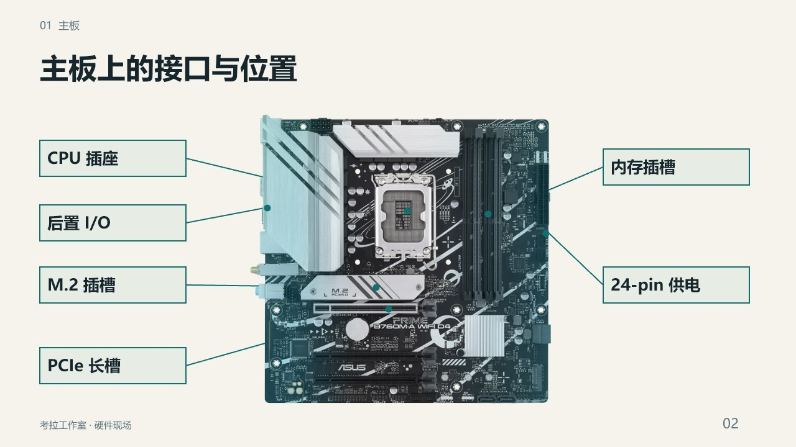

主板为处理器、内存和扩展设备提供连接与供电。图中标出了 CPU 插座、内存插槽、M.2、PCIe 长槽以及供电接头。接口的位置、实际通道和共享关系随型号变化，外观看起来相同的插槽也可能有不同能力。

## 03 CPU Socket 与平台兼容

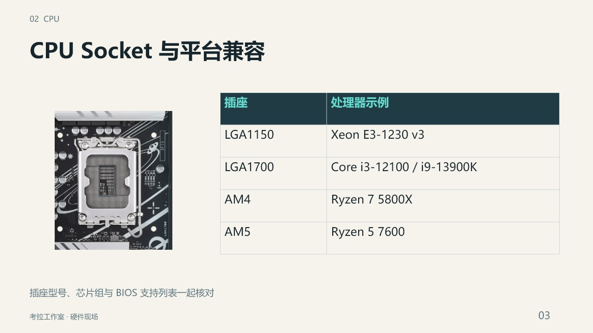

Socket 是 CPU 与主板之间的机械、电气接口。LGA 的弹性触点位于主板插座，AM4 等 PGA 平台的针脚位于 CPU。

## 04 CPU 的安装位置与方向

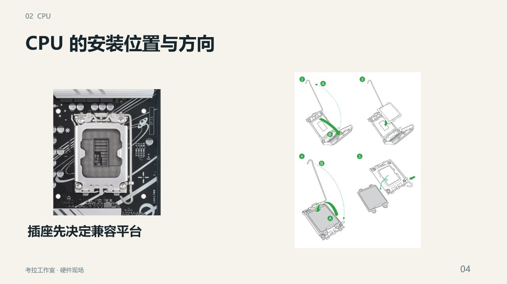

以 LGA1700 为例，打开压杆与压盖，核对定位缺口和三角标记，将 CPU 水平放入，再按手册关闭固定机构。不要触碰插座触点，也不要靠按压芯片寻找安装方向。其他平台的固定机构可能不同。

## 05 一颗 CPU 里面有多个核心

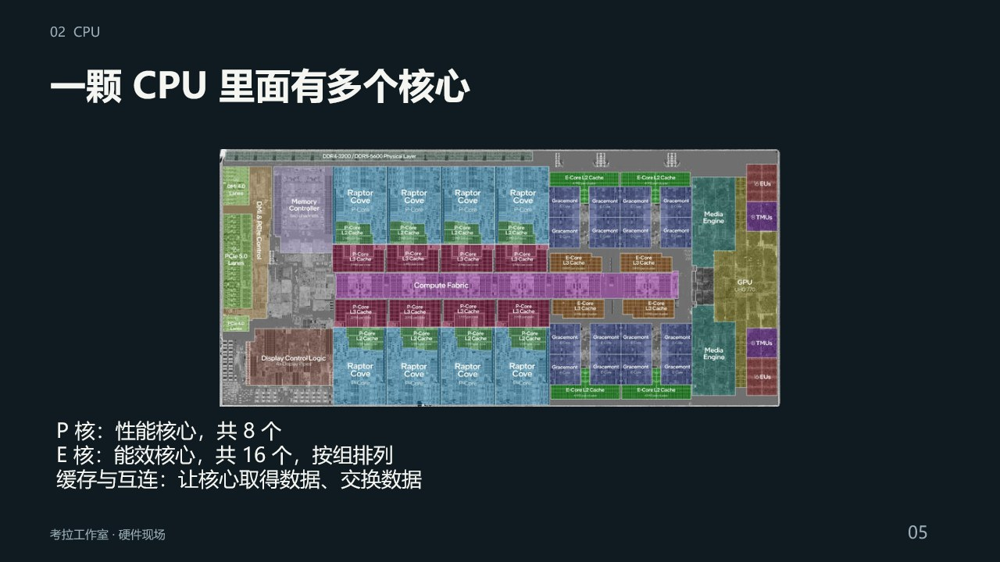

看到的 CPU 外壳是封装，内部芯片还包括计算核心、缓存、内存控制器与互连。图例 i9-13900K 包含 8 个 P 核和 16 个 E 核。不同处理器的内部组织并不相同，核心数量也不能单独决定实际性能。

## 06 核心、缓存与主板内存的关系

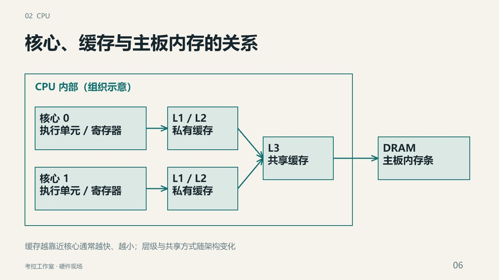

核心使用寄存器和缓存取得运算所需的数据，缓存保存内存数据的副本。图中采用双核、私有 L1/L2 与共享 L3 的简化组织，DRAM 在 CPU 外部。缓存越靠近核心通常越快、越小。

## 07 进程与线程：资源和执行流

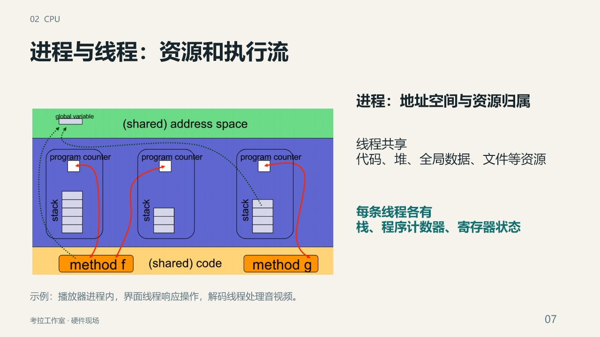

程序是磁盘上的代码，运行后由操作系统建立进程。进程提供地址空间和资源归属，而线程是其中的执行流。同一进程的线程共享代码、堆、全局数据和文件等资源，各有栈、程序计数器和寄存器状态。独立栈不代表线程之间有内存保护，共享数据仍需要同步。一个应用也可能由多个进程组成。

## 08 软件线程怎样使用 CPU

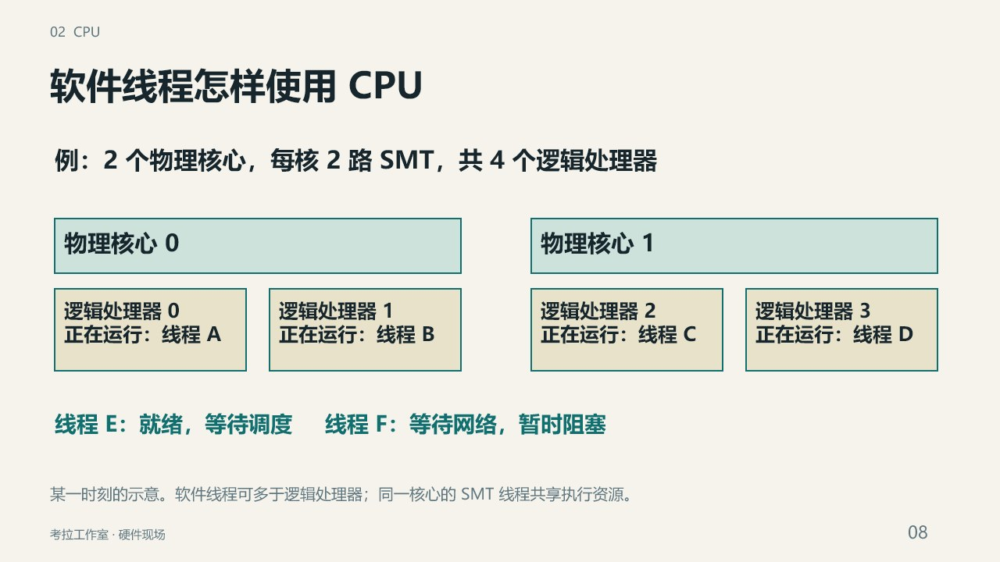

软件线程由操作系统调度到逻辑处理器。图中假设两个物理核心、每核两路 SMT，于是共有四个逻辑处理器；软件线程数可以更多，其余就绪线程等待调度，等待网络等事件的线程则可能阻塞。同一个核心的 SMT 线程共享部分执行资源，性能不会因此固定翻倍。并发是多个任务交替推进，并行则包含同一时刻的共同推进。

## 09 E3、E5、i3、i9 分别是什么

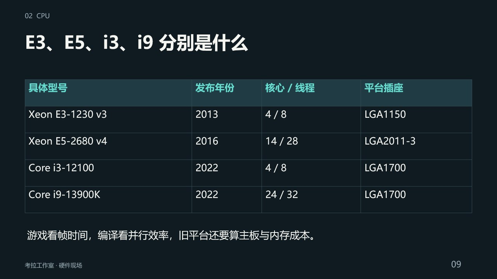

## 10 CPU 怎样发热，热量怎样离开机箱

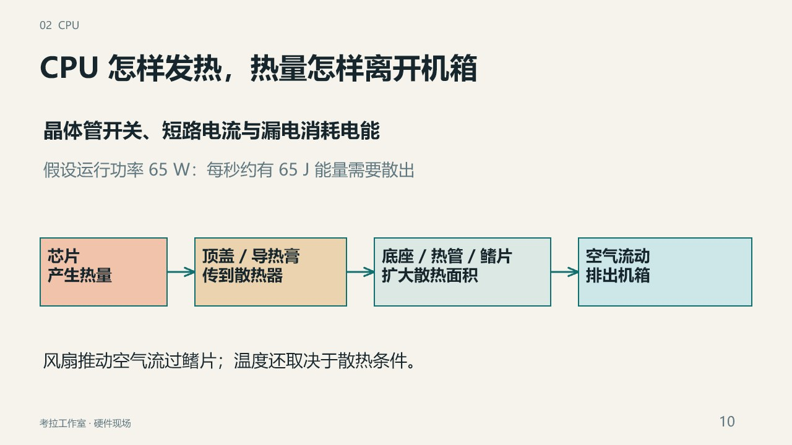

晶体管开关时的充放电、短路电流和漏电会消耗电能，并产生热量。热量从芯片经封装顶盖、导热膏传到散热器，再通过鳍片与空气交换，最后排出机箱。图中的 65 W 是教学假设，表示每秒消耗 65 J 能量，不能当作温度。导热膏填补接触面的微小空隙，风扇负责推动空气流过鳍片。

## 11 常见的三类内存条

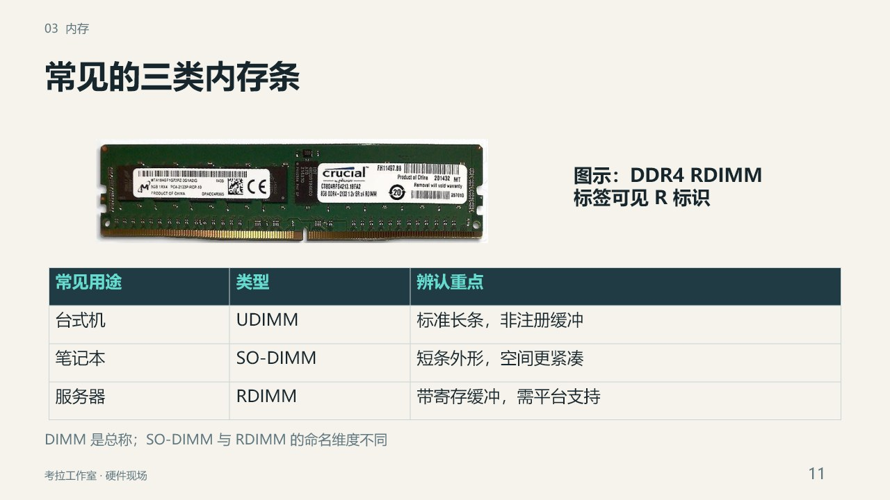

台式机常见 UDIMM，笔记本可更换内存常见 SO-DIMM，服务器常见 RDIMM。严格说 DIMM 是总称，SO-DIMM 描述紧凑外形，RDIMM 描述注册缓冲组织，分类维度不同；ECC 也不等同于 Registered。图中实物是 DDR4 RDIMM，平台需要明确支持相应类型，不能只看 DDR 代际就判断能否互用。

## 12 “内存条插不进去”

内存插不进去时，应先检查代际、方向、防呆缺口与卡扣，强压可能损坏金手指、卡槽或电路板。[原视频：我是不是买到假内存条，插不进去](https://www.bilibili.com/video/BV1dM411Y7fL/)

## 13 内存条怎样装、装在哪

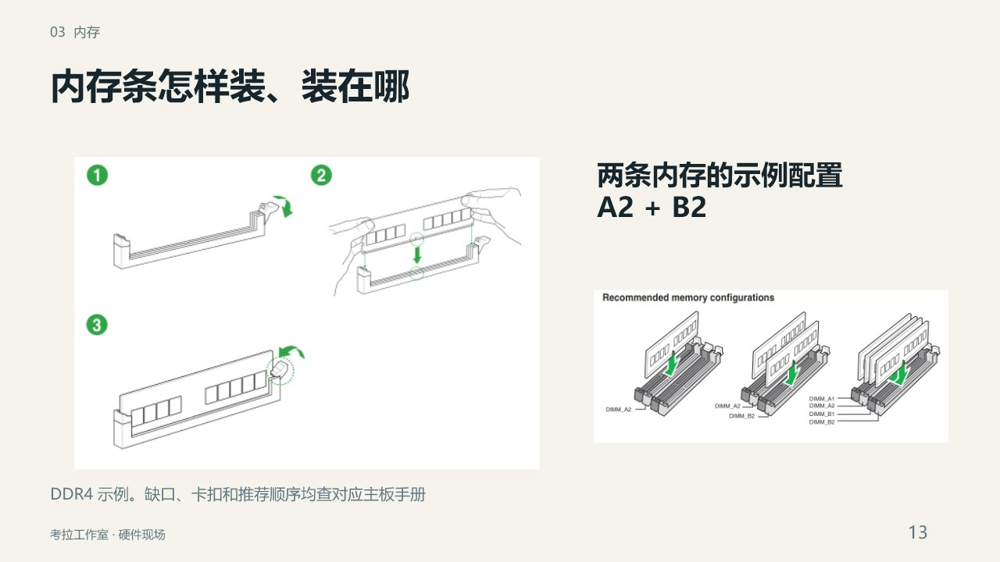

安装前核对 DDR 代际和缺口，按手册打开卡扣，对正后垂直压入并确认锁定。示例主板使用两条内存时推荐 A2、B2，其他型号查各自手册。双通道允许控制器利用两个内存通道，实际性能提升取决于任务；工作集装不下时，也要先解决容量不足。

## 14 顺序遍历数组时，内存里发生什么

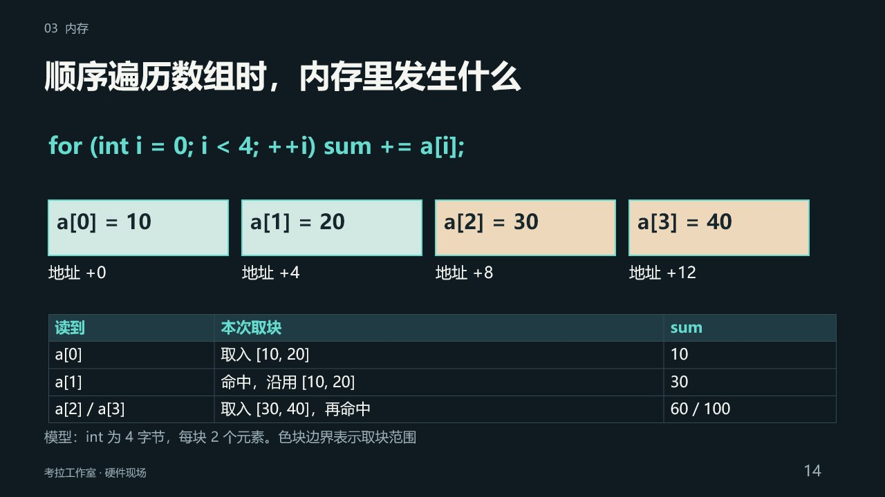

假设 int 为 4 字节，数组连续存放，所以四个元素相对首地址偏移 0、4、8、12 字节。模型规定缓存初始为空、每块两个元素，并假设数组与块边界对齐。读取 10 时会一起取来 20，随后读取 20 就能命中；读取 30 时取来下一块，40 随后命中。sum 从 0 累加到 10、30、60、100，优化后可能保存在寄存器中。

## 15 二维数组按行访问的缓存过程

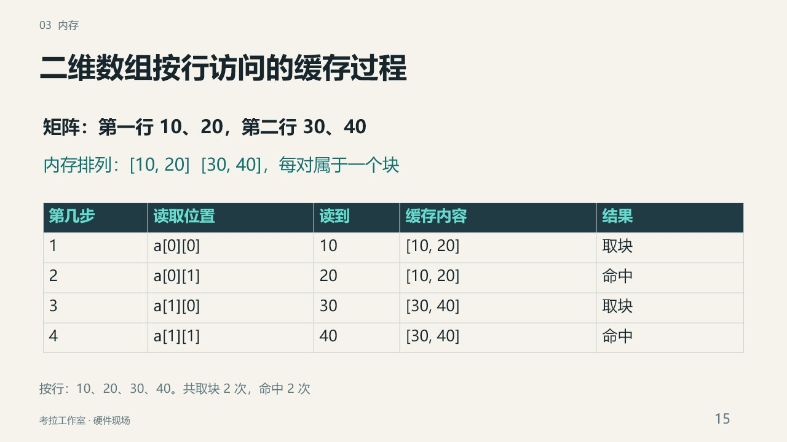

C 二维数组按行连续存放。假设矩阵两行分别为 [10,20]、[30,40]，每块两个元素，缓存只能容纳一块且初始为空。按行依次访问 10、20、30、40：读取 10 和 30 时各取块一次，20 和 40 命中，因此四次访问只需两次取块。这体现了连续访问对空间局部性的利用。

## 16 二维数组按列访问的缓存过程

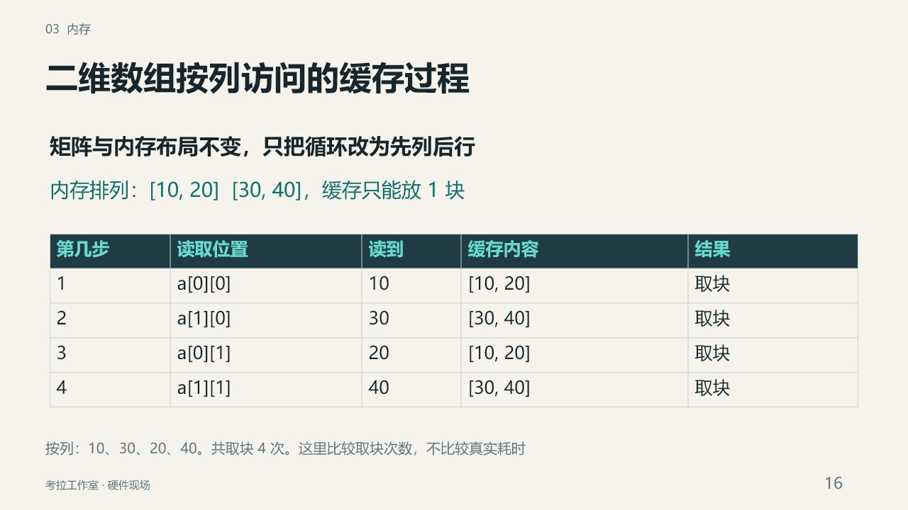

保持上一页的内存布局与缓存条件，只把访问顺序改为按列的 10、30、20、40。两块数据不断相互替换，每次访问都要重新取块，共四次未命中。这个简化模型解释数据复用的差异，不意味着真实运行时间必然是两倍；实际 CPU 还涉及容量更大的多层缓存、预取与其他因素。

## 17 Memory hierarchy：寄存器到硬盘

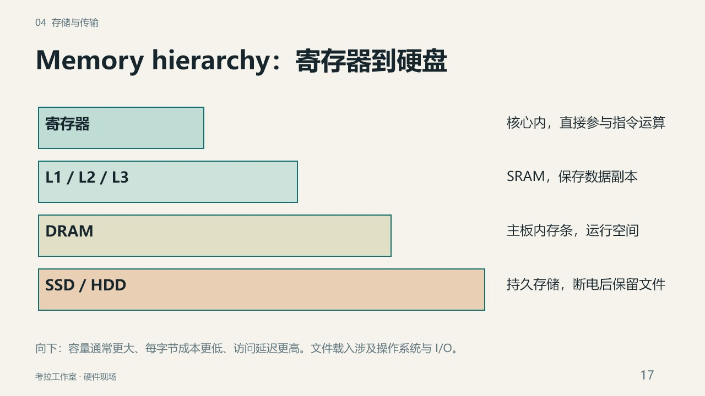

存储层次把寄存器、L1/L2/L3 缓存、DRAM 和 SSD/HDD 联系起来。向下通常容量更大、每字节成本更低、访问延迟更高。缓存与 DRAM 间的常规取数主要由硬件管理，文件从存储进入内存则涉及操作系统与 I/O。扩充硬盘不会增加 DRAM 容量，提高内存容量也不会替代文件的持久保存。

## 18 CPU 核心内部：寄存器怎样参与运算

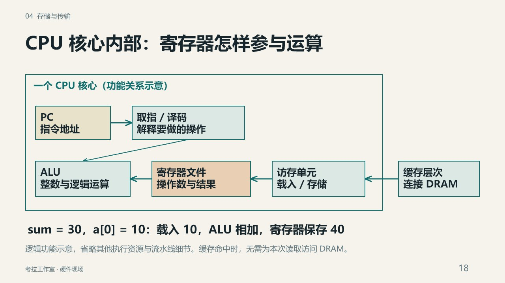

PC 保存指令地址，取指与译码逻辑取得并解释指令，执行单元完成相应操作。寄存器保存正在使用的操作数和结果，ALU 处理整数与逻辑运算，访存单元经缓存载入或存储数据。例如 sum 为 30、a[0] 为 10，可先载入 10，再相加并将 40 留在寄存器中，无须每次都把 sum 写回 DRAM。图是功能关系示意，省略了现代 CPU 的流水线、乱序执行等细节，一行高级语言也未必对应一条机器指令。

## 19 HDD、SSD、M.2、SATA、PCIe 的区别

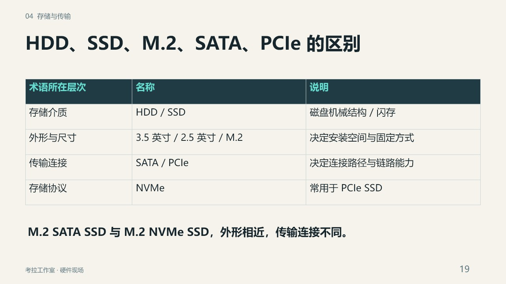

HDD 和 SSD 描述存储技术：前者使用旋转磁盘，后者使用闪存。2.5 英寸、3.5 英寸和 M.2 描述外形规格，SATA、PCIe 描述传输连接，NVMe 是常用于 PCIe SSD 的存储协议。

## 20 SSD 安装在 M.2 插槽

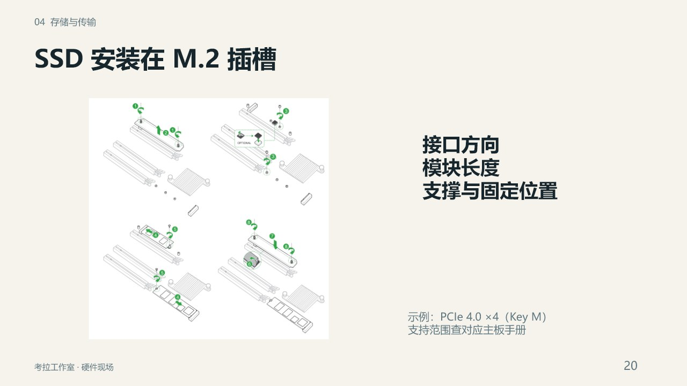

M.2 设备按长度选择支撑位，核对方向后斜插入接口，再压平固定。散热片、导热垫和固定机构按对应手册操作，不能让设备弯曲。示例板的相关 Key M 插槽支持 PCIe 4.0 ×4，其他主板需要核对插槽支持范围。

## 21 速率单位里的小写 b 与大写 B

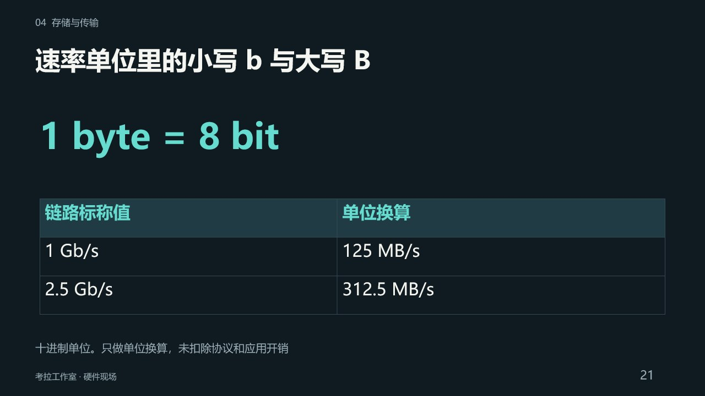

小写 b 表示 bit，大写 B 表示 byte，1 byte = 8 bit。因此 1 Gb/s 换算成 125 MB/s，2.5 Gb/s 换算成 312.5 MB/s。这里使用十进制单位，且只是标称速率的单位换算，实际文件吞吐还受协议开销、存储与软件影响。

## 22 PCIe 代际与通道数

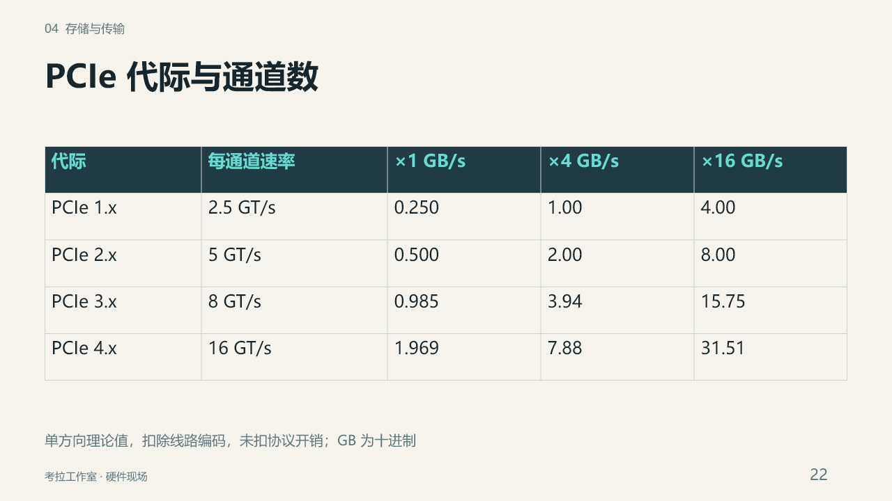

PCIe 代际决定每条 Lane 的传输速率，×1、×4、×16 表示通道数量。表中是单方向、扣除线路编码而未扣除事务等开销的理论带宽，GB 为十进制。

## 23 PCIe 针脚、差分信号与 Lane

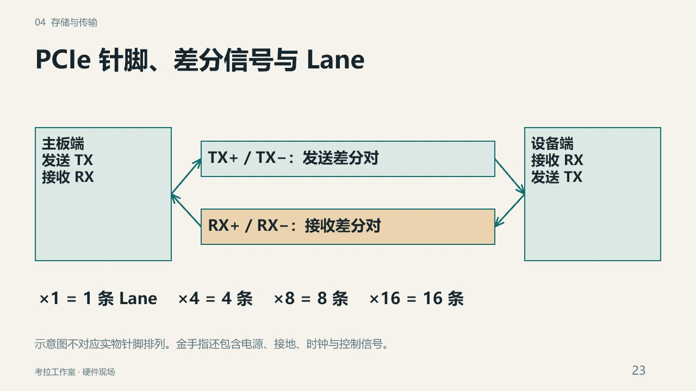

一条 Lane 包含发送差分对与接收差分对，共四根数据信号线，两个方向可同时传输。图中的 TX/RX 以主板为参照：主板 TX 连接设备 RX，主板 RX 连接设备 TX。每个差分对通过两根线的电压差传递信号，正负标记不是电源正负极。连接器还有电源、地、时钟与控制接点，不能把金手指总数除以四来计算 Lane。图只表示连接关系，不表示实际针脚排列。

## 24 PCIe 插槽外形、接点与实际接线

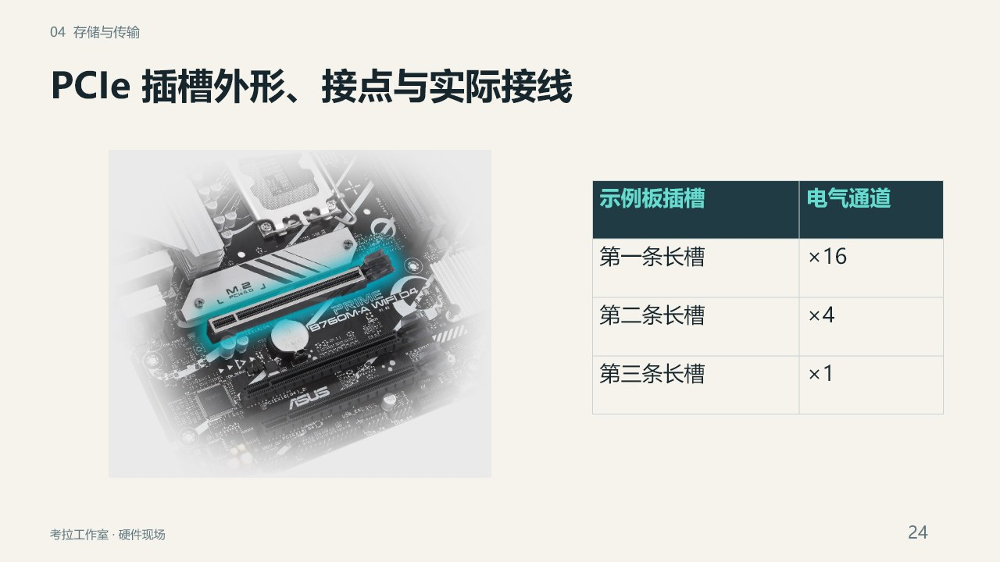

插槽的物理长度、可容纳的金手指和实际连接的通道数需要分开看。示例主板三个长槽分别支持 ×16、×4、×1，不能只看外形断言都能以 ×16 工作。最终链路还需要在主机与设备共同支持的范围内协商代际和宽度，具体共享和限制查主板手册。

## 25 网口、线材与两端设备共同决定速率

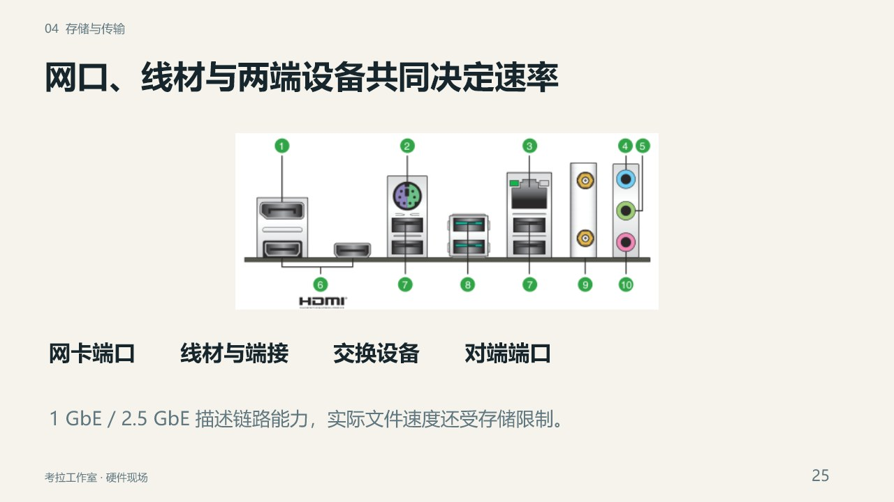

RJ45 外形相同的端口可能支持不同速率。整条链路要跑到 2.5 GbE，需要两端端口、中间交换设备和线材链路共同满足条件并成功协商。符合质量和布线要求的 Cat5e 链路可以支持 2.5GBASE-T，但换一根更好的线不会把千兆端口变成 2.5G。实际文件吞吐还受存储和应用限制。

## 26 USB-C 外形与雷电协议

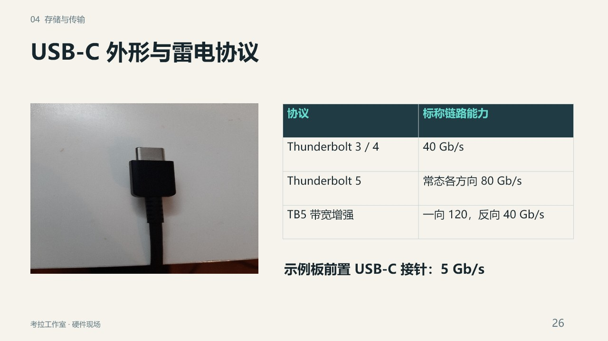

USB-C 描述连接器外形，不能由外观判断协议、速率或供电能力。雷电 3/4 标称 40 Gb/s，雷电 5 常态两个方向各 80 Gb/s，带宽增强可调整为一向 120、反向 40 Gb/s。主机、线材与外设需要相互匹配，链路标称值也不能直接当作 SSD 的净传输速度。示例板前置 USB-C 接针标注为 5 Gb/s，不代表支持雷电。

## 27 陈世先的 400 GB 备份，要多久

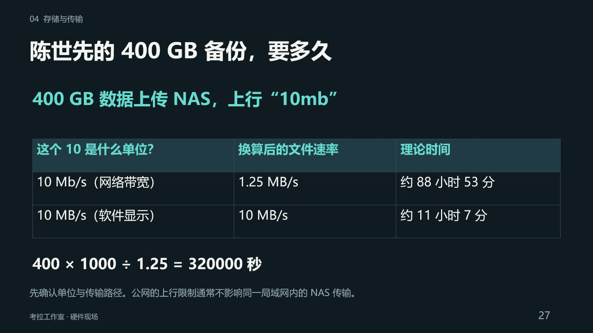

陈世先同学要把 400 GB 数据备份到 NAS，上行却只有“10mb”。先确认单位：10 Mb/s = 1.25 MB/s，400000 ÷ 1.25 = 320000 秒，约 88 小时 53 分；如果软件显示的是 10 MB/s，则约需 11 小时 7 分。计算假设十进制容量和恒定有效速率。

## 28 显卡连接 PCIe 插槽

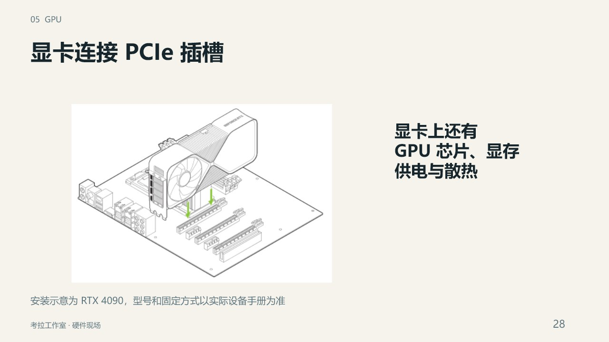

显卡通过 PCIe 与系统连接，卡上还包括 GPU 芯片、显存、供电和散热。安装时按主板手册选择插槽，对正插入并固定挡板，确认空间和支撑，辅助供电按显卡型号说明连接。

## 29 GPU 内部有大量重复的计算组织

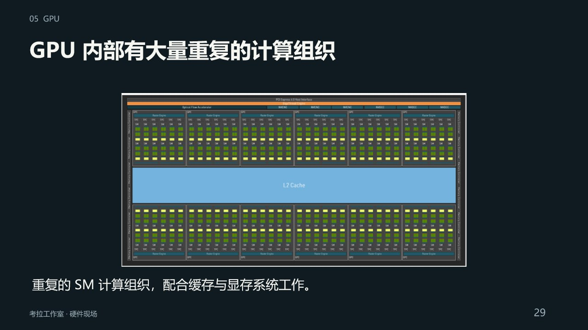

GPU 通过大量重复的计算组织处理高并行任务。图为完整 AD102 设计，其中包含多个 SM，并由缓存、互连和显存系统提供数据。

## 30 Ada SM 的四个计算分区

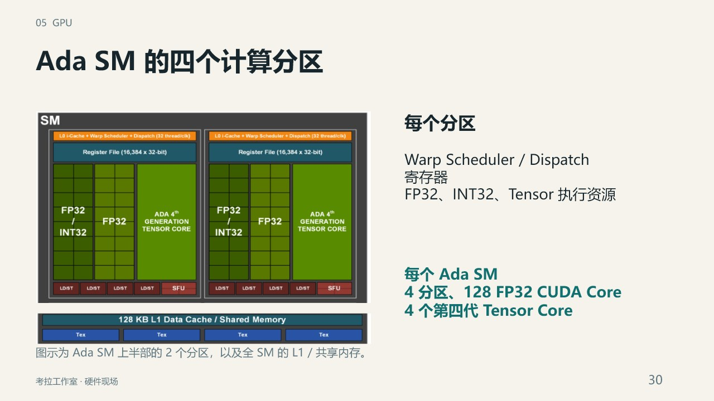

SM 是 Streaming Multiprocessor。Ada SM 有四个计算分区，包含 Warp 调度器、指令派发、寄存器和算术资源，全 SM 提供 128 个 FP32 CUDA Core 和 4 个第四代 Tensor Core。

## 31 SM 怎样执行一批线程

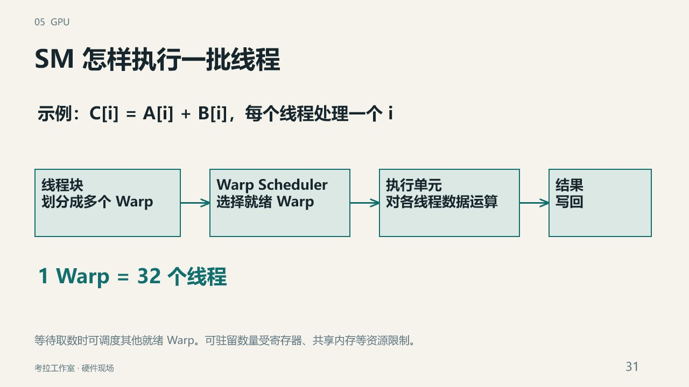

以 C[i] = A[i] + B[i] 为例，一个线程处理一个索引。线程块分配到 SM，线程按每 32 个一组组成 Warp，调度器从就绪 Warp 中选择指令交给执行资源。某个 Warp 等待数据时，可以推进其他就绪 Warp，以隐藏访存延迟。一个线程块在一个 SM 执行，一个 SM 可驻留多个块，数量受寄存器、共享内存等限制。

## 32 SM 的寄存器、共享内存与显存

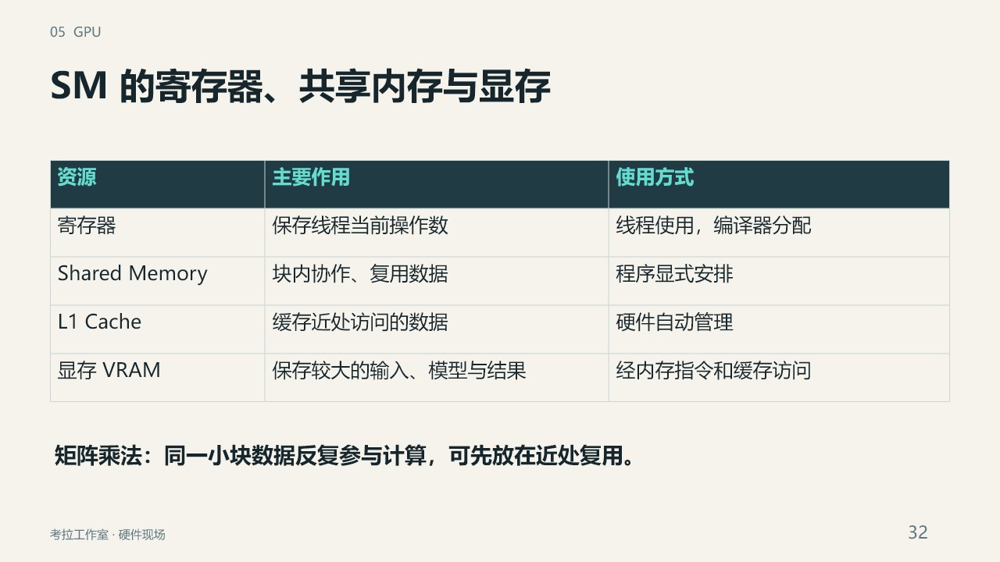

寄存器保存线程当前的操作数，共享内存供同一线程块的线程协作，由程序明确安排。L1 Cache 主要由硬件自动管理，在 Ada 中与共享内存共享部分片上存储资源，但二者使用方式不同。显存保存较大的数组、模型和结果，经缓存与访存通路提供数据。

## 33 游戏与 AI 看重的条件不同

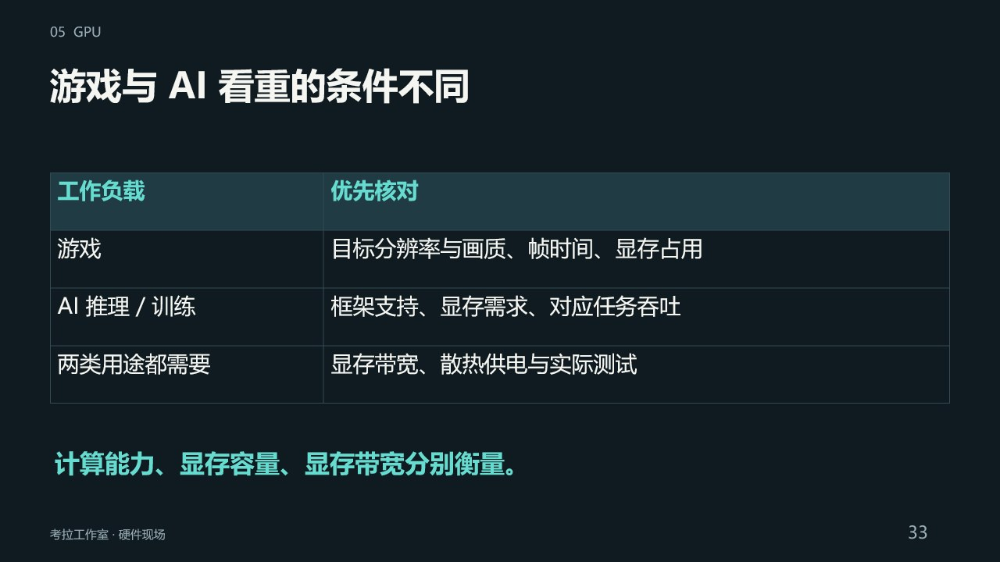

游戏应结合目标分辨率、画质、帧时间和显存占用测试。AI 任务先核对框架与算子支持、显存能否容纳模型和中间数据，再看对应精度与实际任务吞吐。

## 34 程序启动时，这些部件一起工作

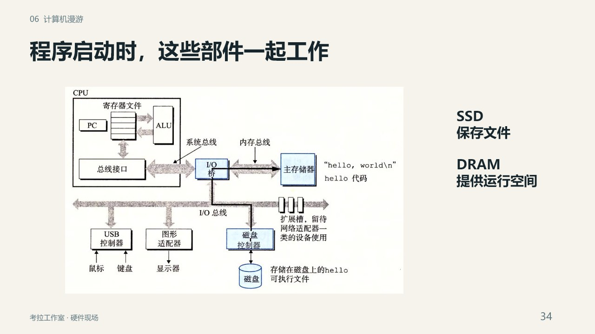

程序文件原先保存在 SSD 等存储设备上，操作系统建立进程与地址空间，按需要把代码和数据映射、载入内存，CPU 再执行相应指令。

## 35 指令执行之后，结果送到设备

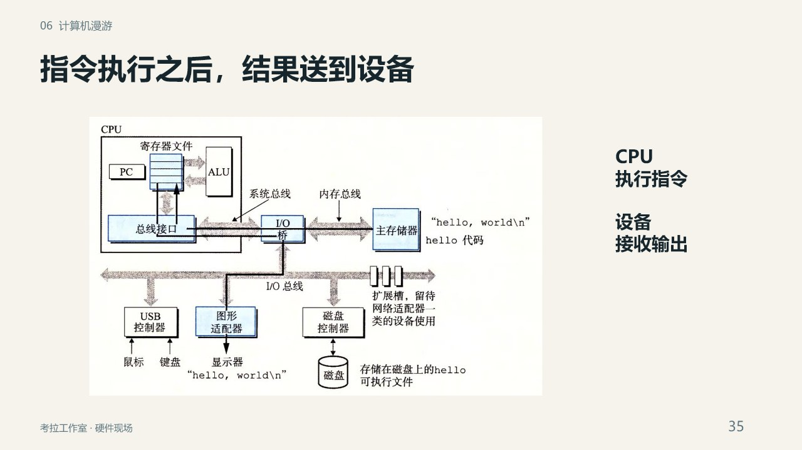

CPU 借助寄存器、缓存和内存取得指令与数据，执行后将结果交给后续代码或设备。输出文字还需要运行库、系统调用与操作系统协调。

## 36 系统调用：用户态与内核态的切换

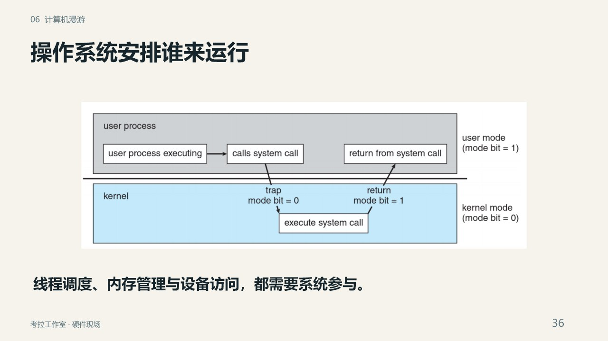

图中主要展示系统调用引发的权限切换：程序在用户态运行，通过受控入口进入内核，由内核检查权限并提供服务，再返回用户态继续执行。mode bit 是教材对权限状态的简化表示。进入内核态不意味着一定更换线程；只有需要等待、被抢占等情况下，才可能发生调度。若等待文件或网络，内核可让当前线程阻塞，安排其他就绪线程运行。

## 37 现在再看桌上的主板

回到整台计算机：CPU 核心与线程决定计算怎样推进，缓存和内存影响数据取得的方式，接口与链路约束传输，GPU 的 SM 与显存共同支持高并行任务。
