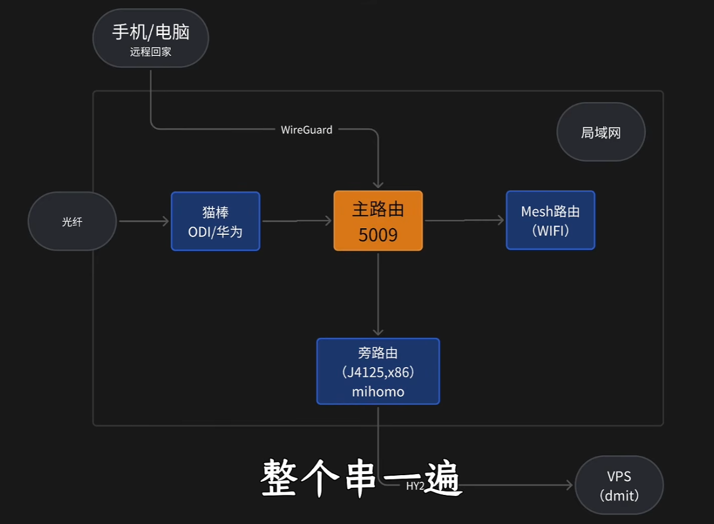
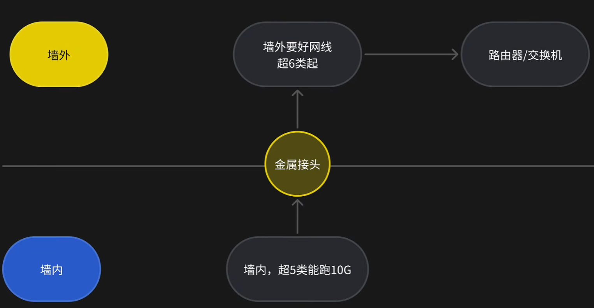

整体的框架其实像这样

## 入户

入户的方向其实比较简单，最简单的方式就是直接用光猫，当然也可以用光电信号转换的模块（猫棒）来实现网络的入户，后者的优点主要体现在能够直接实现2.5g的突破（在有10g光的情况下）

## 主路由

主路由主要的功能就是实现路由转发，一般不会把很多冗余的工作放到主路由上去做

## 旁路由

旁路由主要的功能就是实现主路由之外的一些功能（科学上网），通过在旁路由上搭载mihomo的形式能够实现网络的代理和转发

## mesh组网

注意要用有线就行了，wifi明显要多一层转发

## 网线和连接

## 科学上网

1. 现成机场
2. 自建vps

这个过程中的技术选型其实没有说的很细节，主要的实现方案还是得在具体的实现过程中判断