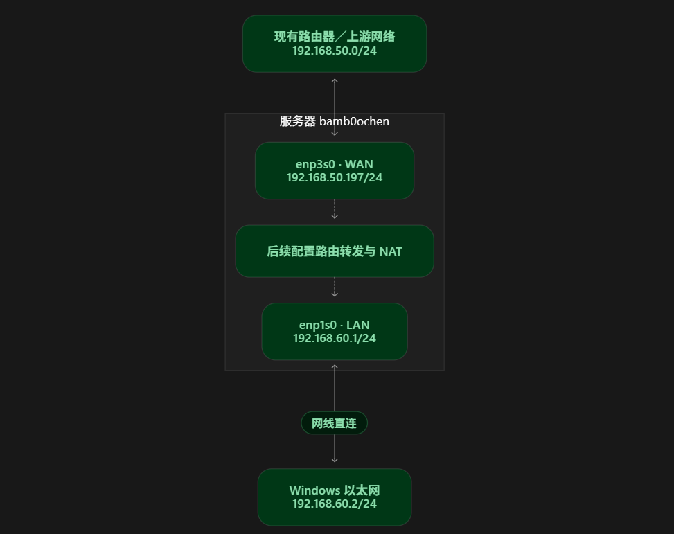
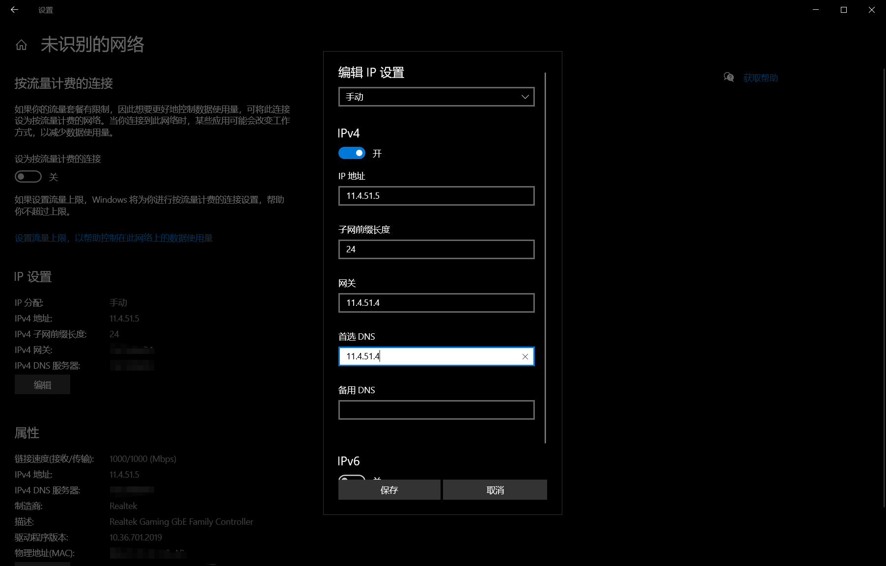
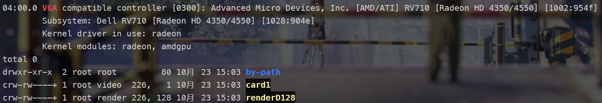
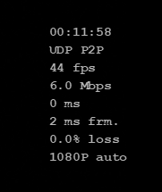
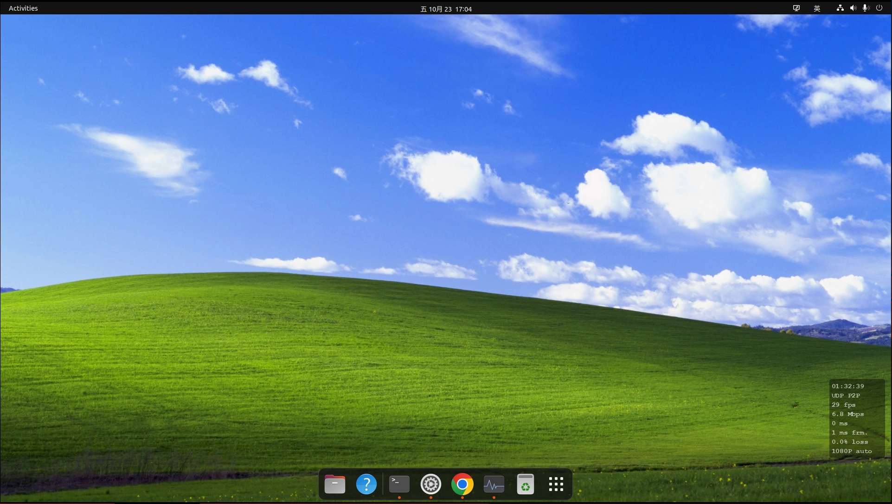

## 材料整理

开始所有的材料：

1. 我自己的win10主机，单板载千兆网口
2. 我自己的linux服务器，单板载千兆，单pcie*1千兆外接网卡
3. 我们的上游路由器，上游是我们的考拉网，下游连接我的linux服务器



## 实验概览

1. 用我的服务器实现防火墙等软路由基础服务
2. 实现两者的静态ip连接，顺便系统学习dhcp等连接过程
3. 实现uu远程连接，让我直接在电脑上有线操纵我的服务器desktop

## 实验一：实现静态IP连接

首先我们看看我们的新地址到底走向了什么方向出站

```bash
ip -4 route get ***.***.***.***（网关）

---

192.168.60.2 via 192.168.50.** dev enp3s0 src 192.168.50.*** uid 1000
    cache
## 说明我们现在的网络其实是从我们网关上出口的，然后从路由器回到我的主机
```

然后这里配置就行了


接着配置我们的win

这个地方要注意服务器的上下游不要写错了，不然就会出现这种报错（或者单纯上不了网）




## 实验二：uu远程配置

然后接下来照理来说就能连接我们的uu远程了

不过linux上没有uu远程，所以我们需要到github上找到相关的插件就行了

首先我们遇到的问题是我们的服务器根本没有输出，这个很简单，我们插个显卡欺骗器就行了

然后接下来我们发现严重的丢帧和延迟，这个在我们目前的网络环境下应该是绝对不能出现的问题

这个时候我们让ai排查到了可能是编码问题

这个地方我们先看几种常见的编码方式

| 编码 | 优点 | 缺点 | 常见用途 |
|---|---|---|---|
| **H.264 / AVC** | 兼容广、实现成熟，容易找到低延迟方案 | 同画质下，通常比新编码更占带宽 | 远控、直播、会议 |
| **H.265 / HEVC** | 压缩效率更高，适合高分辨率视频 | 软件编码通常更费计算资源，兼容性不如 H.264 普遍 | 4K 视频、监控、远控 |
| **VP8** | 成熟的开放视频格式 | 压缩效率较落后 | 较早的浏览器实时音视频 |
| **VP9** | 比上一代有更高压缩效率 | 实时编码和硬件支持需要具体评估 | 网络视频、浏览器 |
| **AV1** | 高压缩效率，采用免版税专利政策 | 软件编码可能很重，硬件编码需要较新的设备 | 网络视频、新设备上的串流 |
| **H.266 / VVC** | 进一步追求高压缩效率 | 实现复杂，应用与硬件支持还需要具体确认 | 高分辨率视频等场景 |

而同一种格式，可以通过 CPU，也可以通过显卡上的专用电路来编码。

| 日志 | 输出格式 | 计算单元 |
|---|---|---|
| `libx264` | H.264 | CPU |
| `libx265` | H.265 | CPU |
| `h264_nvenc` | H.264 | NVIDIA 专用编码硬件 |
| `hevc_nvenc` | H.265 | NVIDIA 专用编码硬件 |
| `h264_vaapi`、`hevc_vaapi` | H.264、H.265 | 通过 VAAPI 使用可用的硬件编码能力 |

在我们对日志的核查中我们发现了libx265

说明我们的传奇e3在吭哧吭哧地编码？！这个时候我们先改成解放cpu的264缓解一下压力

但是问题还存在：我不是有显卡呢？我卡呢？



解决了，原来是我们的上古神秘HD4350根本做不了H264/5的编码

最后我们能看到我们的连接延迟控制在了1ms以内，不过帧数30是硬伤暂且不管了



顺便改了个桌面，要不说mac和ubuntu是亲戚呢



## 实验三：防火墙等软路由实验