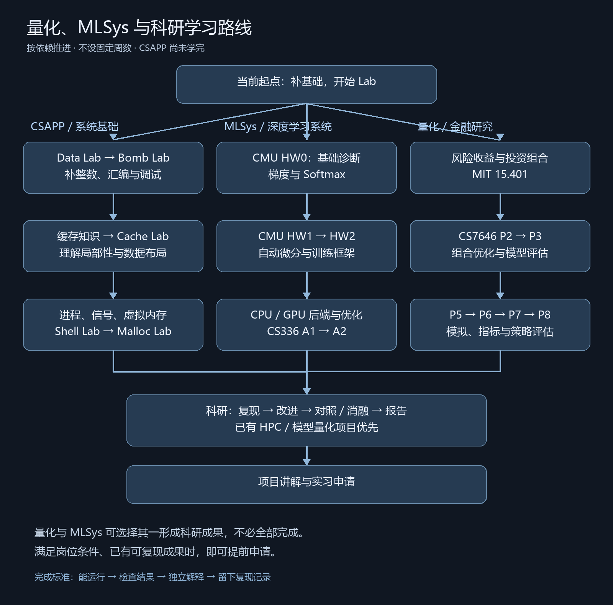

# 学习与科研准备

目标：探索量化研究、MLSys 与科研实习，通过课程 Lab 和可复现项目形成能力证据。按依赖推进，不设固定周数，不要求完成全部课程才申请。

## 当前起点

- CSAPP 看到 Lecture 11，但课程尚未学完，Lab 尚未开始。Lecture 编号因版本而异，以下按教材章节和主题定位。
- OS、MLSys 尚未系统学习，先补实际作业需要的知识。
- 技术与量化两条线并行，每条线同时只推进一个主要 Lab。

## 优先级与目录

| 优先级 | 清单 | 当前动作 |
|---|---|---|
| P0：现在开始 | [CSAPP 基础与 Lab](01-P0-CSAPP.md) | Data Lab；按需补第 2 章，再做 Bomb Lab |
| P0：并行探索 | [量化与金融](02-P0-量化与金融.md) | 风险收益、组合理论；CS7646 P2 |
| P1：基础验证后 | [MLSys](03-P1-MLSys.md) | CMU HW0 检验机器学习基础；逐步推进框架实现 |
| P2：形成成果 | [科研与申请](04-P2-科研与申请.md) | 做深已有 HPC／模型量化项目；满足岗位条件即可申请 |

P0 不表示必须先完成整条路线。CMU HW0 可以提前尝试；遇到基础缺口就回到对应知识，不硬跳到 GPU／分布式优化。

## 路线图



路线图的汇合表示后续可选方向，不要求量化和 MLSys 都完成才做科研或投递。

## 每项完成标准

1. 先读题目、规则和环境要求，自己尝试实现。
2. 卡住后补对应课程；不要因一个卡点重刷整门课。
3. 通过可用测试，能独立解释核心代码、边界条件和一个失败案例。
4. 留下环境、运行命令、结果与个人贡献。在线评分不开放时，不宣称获得官方分数。
5. AI 用于概念解释和调试反馈，遵守课程规则；不把生成的完整解答当作个人掌握。

## 记录模板

每个 Lab 目录保存源码和一份 `NOTES.md`：

```text
课程 / 学期 / 作业版本：
目标与限制：
环境与运行命令：
本次完成：
测试与结果：
失败案例及原因：
个人完成与AI辅助范围：
下次第一步：
```

资料链接沿用已核验的官方入口；课程默认版本、资源权限和硬件要求可能变化，开始作业前以对应学期说明为准。
