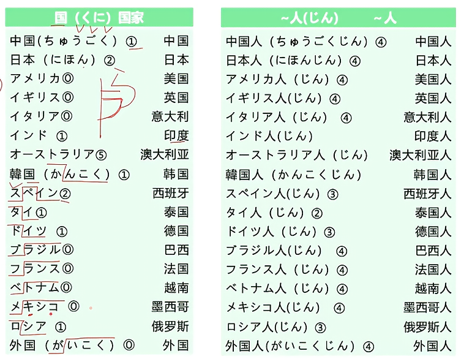
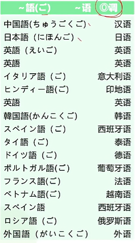
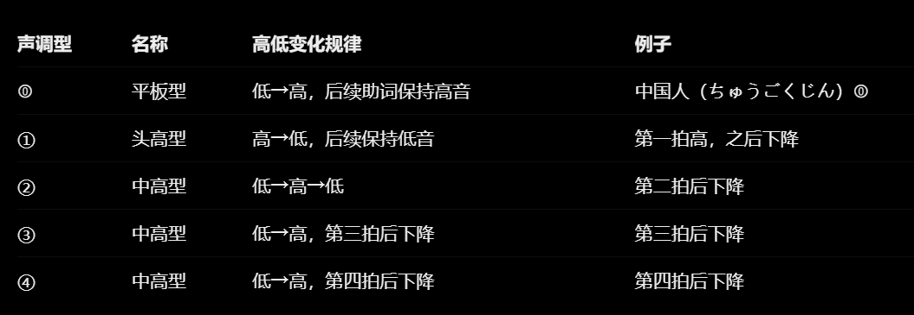
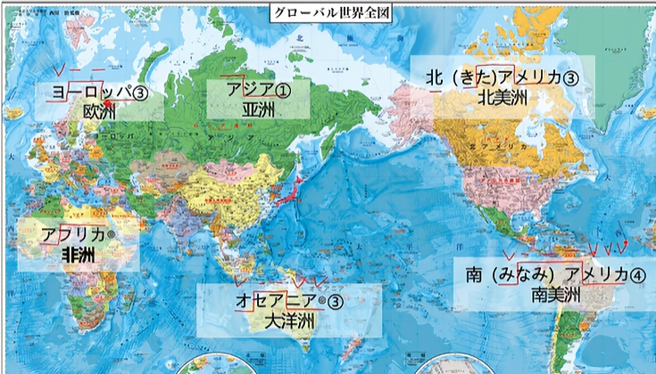
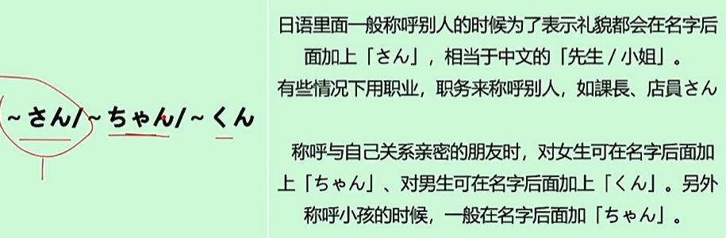
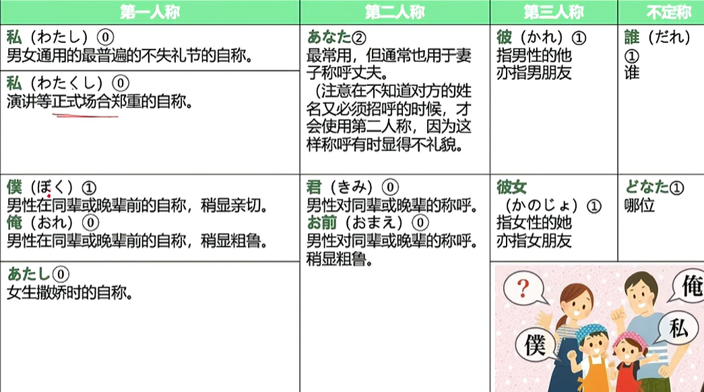

1. 国（くに）
2. 中国（ちゅうごく）
3. 日本（にほん）
4. アメリカ
5. イギリス
6. 外国（がいこく）
7. 人（じん）
8. 語（ご）

　

其中的声调

9. ヨ一ロッパ
10. アジア
11. 北（きた）アメリカ
12. 南（みなみ）アメリカ
13. オセアニア
14. アフリカ

15. がくせい　（全部学生） せいと　（大学以下）
16. せんせい　（先生）
17. りゅがくせい　（留学生）
18. きょうじゅ　（教授）
19. しゃいん　（社員）
20. かいしゃいん　（会社員） #两者的区别在于前面的是一种特指，是一个人自己的属性，后面的是一种职业的泛称
21. てんいん　（店員）
22. けんしゅうせい　（研修生）
23. きぎょう　（企業）
24. だいがく　（大学）
25. ちち　（父）
26. かちょう　（課長）
27. しゃちょう　（社長）
28. でむかえ　（出迎え）
29. あのひと　（あの人）
30. どうも　　（副词 非常）
31.  はい　　（叹词 是）
32.  いいえ　（叹词 不是）
33.  どうぞ　（请）
34.  こちらこそ　（我才是）
35.  ちがいます　（違います）

 