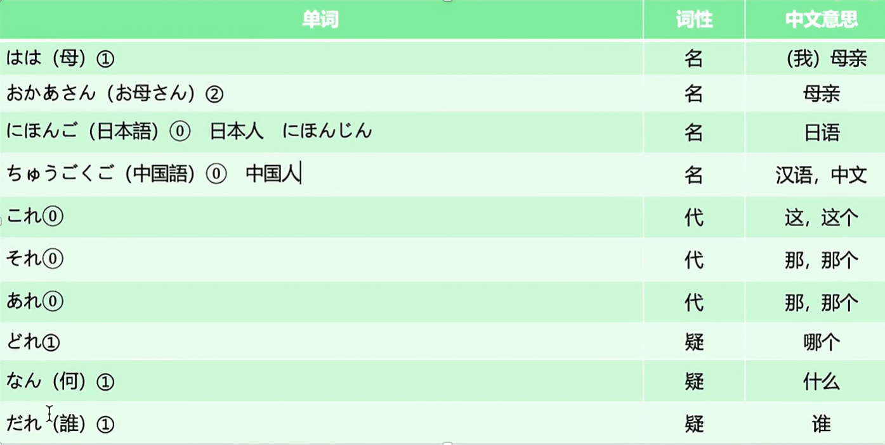
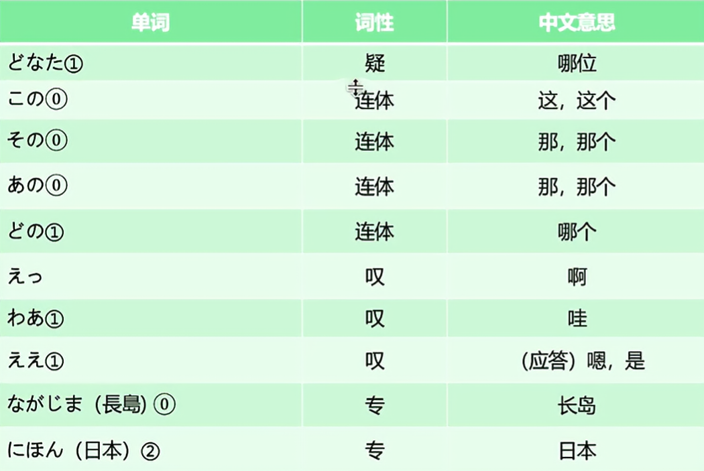
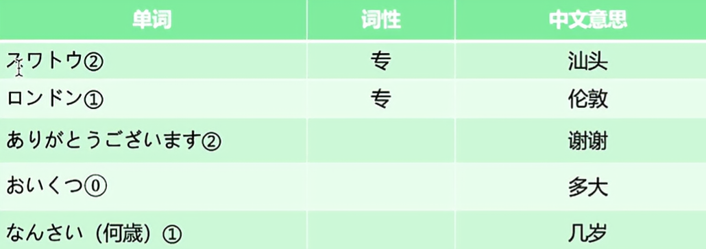
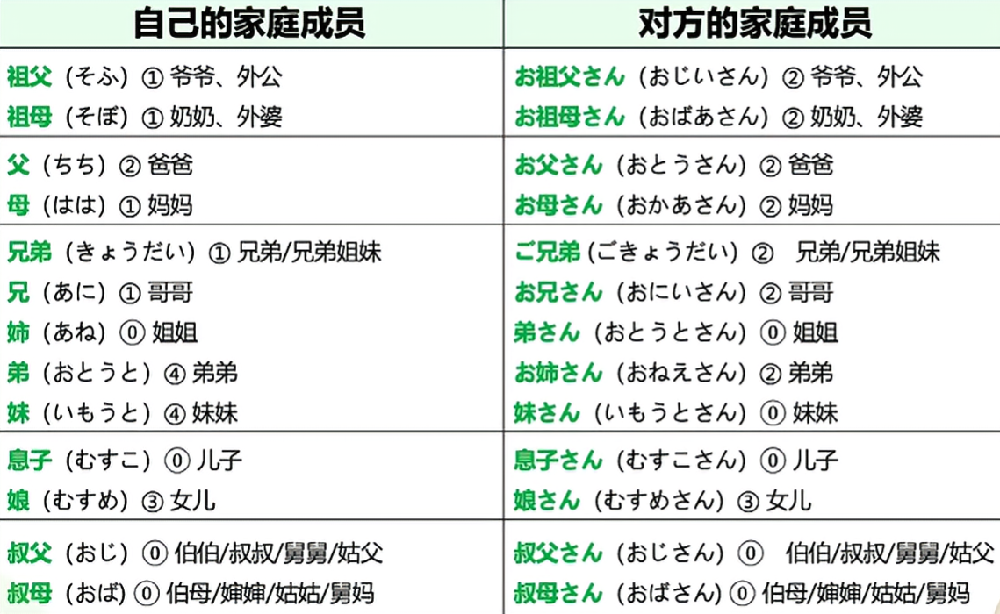
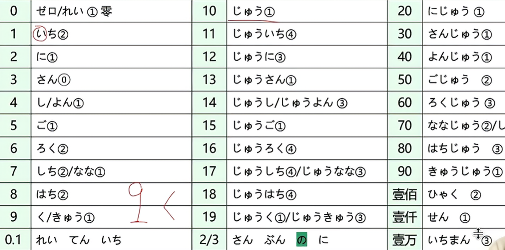

1. ほん　（本）
2. かばん　（鞄，皮包，公文包）
3. ノート （笔记本）
4. えんびつ　（铅笔）
5. かさ　（傘）
6. くつ　（靴）
7. くつした　（靴下，袜子）
8. しんぶん（写作新聞，意为报纸）
9. ざっし　（雑誌）
10. じしょ　（辞書，字典）
11. カメラ　（照相机）
12. テレビ　（电视机）
13. パソコン　（个人电脑）
14. ラジオ　（收音机）
15. でんわ　（電話）
16. つくえ　（机，桌子）
17. いす　（椅子）
18. かぎ　（键，钥匙，锁）
19. とけい　（時計，钟表）
20. うで　（腕）
21. うでどけい　（腕時計）
22. てちょう　（手帳，记事本）
23. しゃしん　（写真，照片）
24. くるま　（車）
25. じてんしゃ　（自転車）
26. じどうしゃ　（自動車）
27. おみやげ　（お土産，土特产）
28. めいさんひん　（名産品）
29. シルク　（丝绸）
30. ハンカチ　（手绢）
31. かいしゃ　（会社）
32. かいぎ　（会議）
33. かた　（方，位，人，敬语）
34. ひと　（人）
35. かぞく　（家族，家人，家属）

其中

長島 由　長い　ながい　 和 島　しま 构成，中间的 い 和　し　通过连读变成了 じ

其中

对于小朋友发问由于可以不用使用敬语所以可以直接问

いくつ？

何歳？

一系列简单的代词叹词等非结构词

家庭的单词budle

